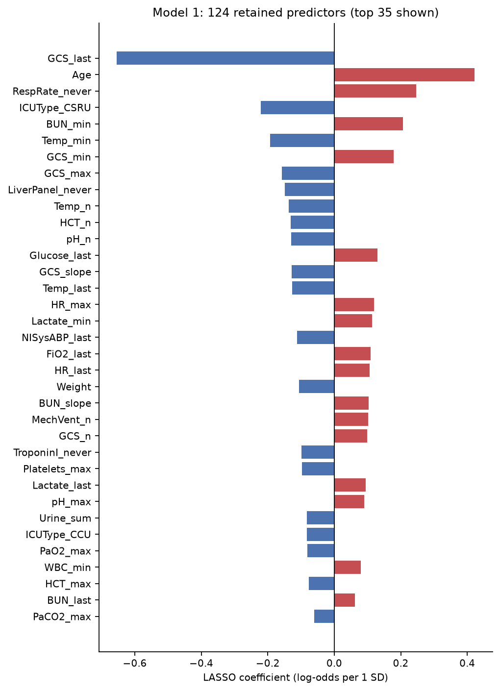
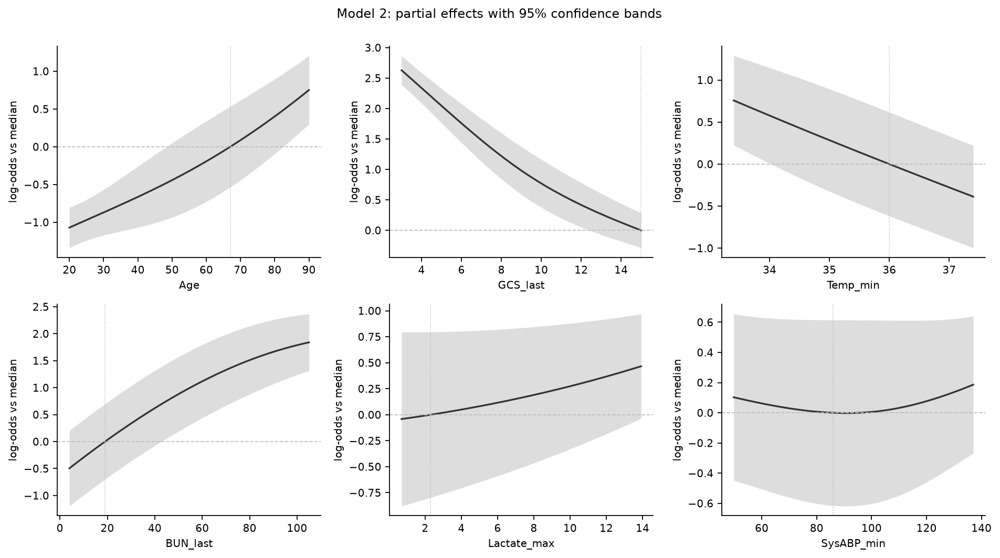
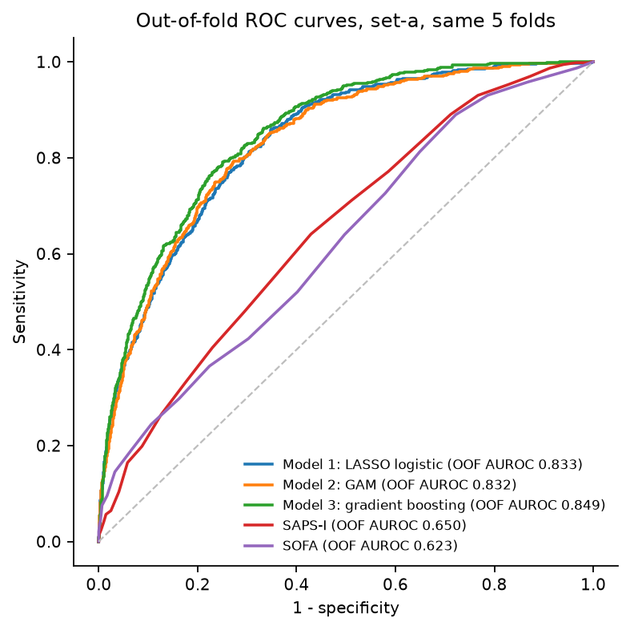
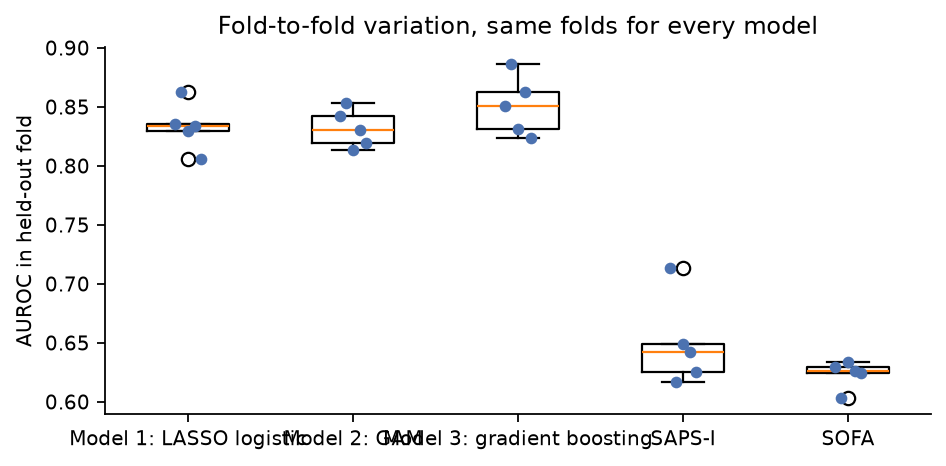

> This is the plain-Markdown copy of the Checkpoint 2 report, written by the same
> `pixi run --locked checkpoint2` command that renders `checkpoint2.html`. The HTML file is the
> version the checklist asks for; this file is the same text without code cells, so it reads
> start to finish in an editor or on the repository page. Tables are Markdown tables and the
> four figures are the PNG files in this folder.


# Checkpoint 2: building and comparing in-hospital mortality models on set-a

**Junjie Cai (jc1206)** — BIOSTAT 707, Duke University  
This notebook is the written report. `pixi run --locked checkpoint2` from this folder executes
it once and writes two readable versions: `output/checkpoint2.html` (the rendered notebook,
the format the checklist asks for) and `output/report.md` (the same text as plain Markdown,
without code cells, for reading in an editor or on the repository page). It takes a few
minutes on a laptop (Apple silicon, 8 cores). Only `data/set-a/` and `data/Outcomes-a.txt` are read. set-b and set-c
are never opened in this checkpoint.

## AI-use statement

I used one AI tool: **Cursor** in agent mode (model: DeepSeek V4 Flash), on 18 October 2026.

*What it was used for.* Drafting the data-preparation code (reading the 4,000 per-stay files,
parsing `HH:MM` times, aggregating the time series into last/minimum/maximum/slope/count), the
scikit-learn and `pygam` model code, the figures, and a first draft of the English prose in this
report.

*What I decided and checked myself.* I chose the modelling-table layout (one row per stay over
hours 0 to 48), the 50% measurement-frequency threshold for dropping a variable as a value, the
predictor groups, the tuning grids, the cross-validation design (5 stratified folds, seed 707),
the final model, and every number reported here. Checks I ran: (i) the code asserts one row per
stay and that `RecordID`, `Length_of_stay` and `Survival` are not predictors; (ii) I confirmed
that imputation and scaling are fitted inside each training fold and not on all of set-a;
(iii) I read the coefficient list and the partial-effect curves against clinical expectations;
(iv) I re-ran the whole pipeline and confirmed that the reported AUROCs match
`output/cp2_model_comparison.csv`.

*Pluses and minuses.* The assistant wrote correct boilerplate quickly (file parsing, fold loops,
table styling), which saved several hours. Its first GAM version used `GCS_min` and `BUN_max`
instead of `GCS_last` and `BUN_last` and omitted the missingness indicators, which cost about
0.05 AUROC in the held-out fold I checked, and it initially mishandled `pygam`'s one-dimensional
probability output; I found both problems from the fold results and fixed them. Some prose
over-claimed and needed editing. I can explain any part of the code or report in an oral check.

## 0. What is compared and how

Three model classes are built on set-a with the same cross-validation (CV) folds: a LASSO
(least absolute shrinkage and selection operator) logistic regression, a logistic generalised
additive model (GAM) with cubic splines, and a gradient-boosted tree ensemble. Two published
severity scores, SAPS-I (Simplified Acute Physiology Score I) and SOFA (Sequential Organ Failure
Assessment), are evaluated on the same folds as benchmarks. Acronyms are defined at first use.

The rest of the report follows the checklist: the modelling table (section 1), predictors
(section 2), the CV design (section 3), the three models (sections 4 to 6), the comparison and
the final model (section 7), the saved artefacts (section 8) and limitations (section 9).

```text
pandas 3.0.6 | scikit-learn 1.9.1 | pygam 0.12.0
```

## 1. Data, outcome and layout

Table 1 shows the size of the modelling table used everywhere below: 4,000 ICU (intensive care
unit) stays with 554 in-hospital deaths (**13.85%**). That is the whole cohort, not a subset,
and no stay is lost when the predictors are built. The outcome is `In-hospital_death` from `Outcomes-a.txt`, joined to the
measurements by `RecordID`. The layout is **one row per ICU stay**: all time-series predictors
summarise hours 0 to 48 of that stay, so a stay contributes exactly one row and each row is in
exactly one CV fold. Because a stay cannot appear in two folds, no grouped CV is needed here; the
code checks that `RecordID` is unique, that there are 4,000 rows, and that the outcome is complete.

The cleaning decisions from Checkpoint 1 are carried over:

* The value `-1` is the challenge's code for "not measured" and was set to missing (2,247 raw
  values). The same code in `SAPS-I` and `SOFA` was set to missing (190 and 144 stays); those
  stays are skipped only when the benchmark scores are evaluated.
* `FiO2` was recorded in percent for part of the cohort: values between 1 and 100 were divided by
  100, and `FiO2 = 0` was treated as missing (inspired oxygen fraction below 0.21 is impossible).
* `Height` recorded in metres (1.2 to 2.5) or inches (40 to 90) was converted to centimetres;
  values outside 100 to 250 cm were dropped, as were weight outside 20 to 300 kg and age outside
  15 to 120 years.
* Physiologically implausible values were dropped using the variable-specific bounds from
  Checkpoint 1 (for example heart rate 20 to 250 bpm, temperature 30 to 45 degrees C, pH 6.5 to
  8.0, creatinine 0.1 to 30 mg/dL).
* All records fall inside 0 to 48 hours, so no observation is excluded by time.
* Admission weight is the value recorded at 00:00. Later weight measurements were not used
  because they largely reflect fluid resuscitation during the window.

**Table 1. Size and outcome of the set-a modelling table**

| Item | Value |
| --- | --- |
| ICU stays (one row each) | 4,000 |
| In-hospital deaths | 554 |
| Deaths (%) | 13.85% |
| Candidate predictors | 124 |
| Raw measurements read | 1,757,980 |
| Observation window (hours) | 0 to 48 |

**Table 2. Variables dropped as values because they were measured in fewer than 50% of stays**

| variable | stays_measured | pct_measured | decision |
| --- | --- | --- | --- |
| TroponinI | 205 | 5.1 | values dropped (too sparse); never-measured flag kept |
| Cholesterol | 305 | 7.6 | values dropped (too sparse), no flag kept |
| TroponinT | 863 | 21.6 | values dropped (too sparse); never-measured flag kept |
| RespRate | 1,101 | 27.5 | values dropped (too sparse); never-measured flag kept |
| Albumin | 1,615 | 40.4 | values dropped (too sparse); never-measured flag kept |
| ALP | 1,690 | 42.2 | values dropped (too sparse); never-measured flag kept |
| Bilirubin | 1,718 | 43.0 | values dropped (too sparse); never-measured flag kept |
| ALT | 1,721 | 43.0 | values dropped (too sparse); never-measured flag kept |
| AST | 1,725 | 43.1 | values dropped (too sparse); never-measured flag kept |
| SaO2 | 1,792 | 44.8 | values dropped (too sparse), no flag kept |

```text
Height is missing for 47.7% of stays and admission weight for 8.2%. Lactate is missing for 45.4%.
```

Table 2 is the exclusion list required by the checklist: ten time-series variables were measured
in fewer than 50% of the 4,000 stays, so I did not use their values. For troponin I and T, the
liver panel (ALP, ALT, AST and bilirubin), albumin and respiratory rate, the *never measured*
indicator is kept as a predictor, because Checkpoint 1 showed that whether a test was ordered is
itself informative (troponin I: 27.8% mortality when measured versus 13.1% when not). SaO2 and
cholesterol were rare and added nothing in the Checkpoint 1 missingness plots, so they were
dropped completely.

## 2. Predictors

The 124 predictors fall into seven groups (Table 3). All of them use only data from hours 0 to
48. Table 4 lists every predictor with the measurement behind it.

**Table 3. Predictor groups**

| Group | Number of predictors | Why this group |
| --- | --- | --- |
| Admission | 7 | Known at ICU admission; age and sex set the baseline risk, weight and height proxy body habitus. |
| Latest value | 24 | Most recent value in hours 0-48: the current physiological state at the end of the prediction window. |
| Minimum | 24 | Worst low value in hours 0-48: captures hypotensive, hypoxic or haematological nadirs. |
| Maximum | 24 | Worst high value in hours 0-48: captures fever, tachycardia, hypertension and peaks of renal or liver markers. |
| Trend | 8 | Least-squares slope per hour over hours 0-48: direction of deterioration or recovery. |
| Monitoring intensity | 28 | Number of valid measurements in hours 0-48, or total urine output: how closely the patient was watched and how much urine was produced. |
| Missingness | 9 | Indicator that a variable was never measured, or that an admission value was not recorded: ordering a test is itself a clinical decision and is informative. |

**Table 4. All 124 predictors, grouped by type**

| Group | Predictor | Measurement behind it |
| --- | --- | --- |
| Admission | Age | Age at admission (years) |
| Admission | Gender | Sex, 1 = male |
| Admission | Height | Height (cm) after unit harmonisation |
| Admission | ICUType_CCU | ICU type, one-hot with MICU as reference |
| Admission | ICUType_CSRU | ICU type, one-hot with MICU as reference |
| Admission | ICUType_SICU | ICU type, one-hot with MICU as reference |
| Admission | Weight | Admission weight (kg) |
| Latest value | BUN_last | Blood urea nitrogen (mg/dL) |
| Latest value | Creatinine_last | Serum creatinine (mg/dL) |
| Latest value | DiasABP_last | Invasive diastolic arterial pressure (mmHg) |
| Latest value | FiO2_last | Inspired oxygen fraction (0.21-1.0) |
| Latest value | GCS_last | Glasgow Coma Scale (3-15) |
| Latest value | Glucose_last | Blood glucose (mg/dL) |
| Latest value | HCO3_last | Serum bicarbonate (mmol/L) |
| Latest value | HCT_last | Haematocrit (%) |
| Latest value | HR_last | Heart rate (bpm) |
| Latest value | K_last | Serum potassium (mmol/L) |
| Latest value | Lactate_last | Serum lactate (mmol/L) |
| Latest value | MAP_last | Invasive mean arterial pressure (mmHg) |
| Latest value | Mg_last | Serum magnesium (mmol/L) |
| Latest value | NIDiasABP_last | Non-invasive diastolic pressure (mmHg) |
| Latest value | NIMAP_last | Non-invasive mean pressure (mmHg) |
| Latest value | NISysABP_last | Non-invasive systolic pressure (mmHg) |
| Latest value | Na_last | Serum sodium (mmol/L) |
| Latest value | PaCO2_last | Arterial CO2 partial pressure (mmHg) |
| Latest value | PaO2_last | Arterial O2 partial pressure (mmHg) |
| Latest value | Platelets_last | Platelet count (10^3/muL) |
| Latest value | SysABP_last | Invasive systolic arterial pressure (mmHg) |
| Latest value | Temp_last | Temperature (degrees C) |
| Latest value | WBC_last | White blood cell count (10^3/muL) |
| Latest value | pH_last | Arterial pH |
| Minimum | BUN_min | Blood urea nitrogen (mg/dL) |
| Minimum | Creatinine_min | Serum creatinine (mg/dL) |
| Minimum | DiasABP_min | Invasive diastolic arterial pressure (mmHg) |
| Minimum | FiO2_min | Inspired oxygen fraction (0.21-1.0) |
| Minimum | GCS_min | Glasgow Coma Scale (3-15) |
| Minimum | Glucose_min | Blood glucose (mg/dL) |
| Minimum | HCO3_min | Serum bicarbonate (mmol/L) |
| Minimum | HCT_min | Haematocrit (%) |
| Minimum | HR_min | Heart rate (bpm) |
| Minimum | K_min | Serum potassium (mmol/L) |
| Minimum | Lactate_min | Serum lactate (mmol/L) |
| Minimum | MAP_min | Invasive mean arterial pressure (mmHg) |
| Minimum | Mg_min | Serum magnesium (mmol/L) |
| Minimum | NIDiasABP_min | Non-invasive diastolic pressure (mmHg) |
| Minimum | NIMAP_min | Non-invasive mean pressure (mmHg) |
| Minimum | NISysABP_min | Non-invasive systolic pressure (mmHg) |
| Minimum | Na_min | Serum sodium (mmol/L) |
| Minimum | PaCO2_min | Arterial CO2 partial pressure (mmHg) |
| Minimum | PaO2_min | Arterial O2 partial pressure (mmHg) |
| Minimum | Platelets_min | Platelet count (10^3/muL) |
| Minimum | SysABP_min | Invasive systolic arterial pressure (mmHg) |
| Minimum | Temp_min | Temperature (degrees C) |
| Minimum | WBC_min | White blood cell count (10^3/muL) |
| Minimum | pH_min | Arterial pH |
| Maximum | BUN_max | Blood urea nitrogen (mg/dL) |
| Maximum | Creatinine_max | Serum creatinine (mg/dL) |
| Maximum | DiasABP_max | Invasive diastolic arterial pressure (mmHg) |
| Maximum | FiO2_max | Inspired oxygen fraction (0.21-1.0) |
| Maximum | GCS_max | Glasgow Coma Scale (3-15) |
| Maximum | Glucose_max | Blood glucose (mg/dL) |
| Maximum | HCO3_max | Serum bicarbonate (mmol/L) |
| Maximum | HCT_max | Haematocrit (%) |
| Maximum | HR_max | Heart rate (bpm) |
| Maximum | K_max | Serum potassium (mmol/L) |
| Maximum | Lactate_max | Serum lactate (mmol/L) |
| Maximum | MAP_max | Invasive mean arterial pressure (mmHg) |
| Maximum | Mg_max | Serum magnesium (mmol/L) |
| Maximum | NIDiasABP_max | Non-invasive diastolic pressure (mmHg) |
| Maximum | NIMAP_max | Non-invasive mean pressure (mmHg) |
| Maximum | NISysABP_max | Non-invasive systolic pressure (mmHg) |
| Maximum | Na_max | Serum sodium (mmol/L) |
| Maximum | PaCO2_max | Arterial CO2 partial pressure (mmHg) |
| Maximum | PaO2_max | Arterial O2 partial pressure (mmHg) |
| Maximum | Platelets_max | Platelet count (10^3/muL) |
| Maximum | SysABP_max | Invasive systolic arterial pressure (mmHg) |
| Maximum | Temp_max | Temperature (degrees C) |
| Maximum | WBC_max | White blood cell count (10^3/muL) |
| Maximum | pH_max | Arterial pH |
| Trend | BUN_slope | Blood urea nitrogen (mg/dL) |
| Trend | Creatinine_slope | Serum creatinine (mg/dL) |
| Trend | GCS_slope | Glasgow Coma Scale (3-15) |
| Trend | HR_slope | Heart rate (bpm) |
| Trend | Lactate_slope | Serum lactate (mmol/L) |
| Trend | SysABP_slope | Invasive systolic arterial pressure (mmHg) |
| Trend | Temp_slope | Temperature (degrees C) |
| Trend | WBC_slope | White blood cell count (10^3/muL) |
| Monitoring intensity | BUN_n | Blood urea nitrogen (mg/dL) |
| Monitoring intensity | Creatinine_n | Serum creatinine (mg/dL) |
| Monitoring intensity | DiasABP_n | Invasive diastolic arterial pressure (mmHg) |
| Monitoring intensity | FiO2_n | Inspired oxygen fraction (0.21-1.0) |
| Monitoring intensity | GCS_n | Glasgow Coma Scale (3-15) |
| Monitoring intensity | Glucose_n | Blood glucose (mg/dL) |
| Monitoring intensity | HCO3_n | Serum bicarbonate (mmol/L) |
| Monitoring intensity | HCT_n | Haematocrit (%) |
| Monitoring intensity | HR_n | Heart rate (bpm) |
| Monitoring intensity | K_n | Serum potassium (mmol/L) |
| Monitoring intensity | Lactate_n | Serum lactate (mmol/L) |
| Monitoring intensity | MAP_n | Invasive mean arterial pressure (mmHg) |
| Monitoring intensity | MechVent_any | Mechanical ventilation recorded (1 = ventilated) |
| Monitoring intensity | MechVent_n | Mechanical ventilation recorded (1 = ventilated) |
| Monitoring intensity | Mg_n | Serum magnesium (mmol/L) |
| Monitoring intensity | NIDiasABP_n | Non-invasive diastolic pressure (mmHg) |
| Monitoring intensity | NIMAP_n | Non-invasive mean pressure (mmHg) |
| Monitoring intensity | NISysABP_n | Non-invasive systolic pressure (mmHg) |
| Monitoring intensity | Na_n | Serum sodium (mmol/L) |
| Monitoring intensity | PaCO2_n | Arterial CO2 partial pressure (mmHg) |
| Monitoring intensity | PaO2_n | Arterial O2 partial pressure (mmHg) |
| Monitoring intensity | Platelets_n | Platelet count (10^3/muL) |
| Monitoring intensity | SysABP_n | Invasive systolic arterial pressure (mmHg) |
| Monitoring intensity | Temp_n | Temperature (degrees C) |
| Monitoring intensity | Urine_n | Hourly urine output (mL) |
| Monitoring intensity | Urine_sum | Hourly urine output (mL) |
| Monitoring intensity | WBC_n | White blood cell count (10^3/muL) |
| Monitoring intensity | pH_n | Arterial pH |
| Missingness | Albumin_never | Albumin never measured in hours 0-48 (indicator) |
| Missingness | Gender_missing | Sex not recorded (indicator) |
| Missingness | Height_missing | Height not recorded at admission (indicator) |
| Missingness | ICUType_missing | ICU type not recorded (indicator) |
| Missingness | LiverPanel_never | None of ALP, ALT, AST or bilirubin measured in hours 0-48 (indicator) |
| Missingness | RespRate_never | Respiratory rate never measured in hours 0-48 (indicator) |
| Missingness | TroponinI_never | Troponin I never measured in hours 0-48 (indicator) |
| Missingness | TroponinT_never | Troponin T never measured in hours 0-48 (indicator) |
| Missingness | Weight_missing | Admission weight not recorded (indicator) |

```text
Total predictors: 124; events: 554
```

Read Table 4 by group. *Admission* variables are age, sex, height, admission weight and the three
ICU-type dummies (medical ICU, MICU, is the reference).
*Latest value*, *minimum*, *maximum* and *trend* describe each of 24 time-series variables: the
most recent value, the worst low, the worst high, and the least-squares slope per hour (slope is
computed for the eight variables whose direction of change is clinically central: heart rate,
systolic pressure, temperature, GCS, BUN, creatinine, lactate and white cell count).
*Monitoring intensity* is the number of valid measurements of each variable (0 when never
measured), total urine volume over 48 hours, and whether the patient was ever recorded as
mechanically ventilated. *Missingness* holds the never-measured indicators for the variables in
Table 2 and indicators for admission values that were not recorded (height, weight, sex, ICU
type).

Three choices need a reason:

* `ICUType` is categorical, not a number from 1 to 4; the three dummies are used with MICU
  (medical intensive care unit) as the reference, so the coefficients are contrasts against MICU.
  The others are CSRU (cardiac surgery recovery unit), CCU (coronary care unit) and SICU (surgical
  intensive care unit).
* `Length_of_stay` and `Survival` are never predictors. They describe what happened after the
  48-hour window and would be leakage; they are not even read into the modelling table.
* SAPS-I and SOFA are benchmarks, not predictors. They are kept in the table for section 7 only
  and are excluded from the predictor list in code.

The count of measurements doubles as a missingness predictor: a variable that was measured 30
times tells us the patient was monitored closely, and a variable never measured tells us the team
did not suspect that problem. These are clinical decisions, not random missingness, so they are
kept as predictors but will not be read causally (see section 9).

## 3. Cross-validation design

The design is **stratified 5-fold CV on set-a**, with the folds split by stay (here one row per
stay, so each stay is in exactly one fold and no grouped CV is required). The seed is fixed at
707, and the fold vector is saved to `output/cp2_folds.csv`. Every model, including the two
benchmarks, uses exactly these folds, so a difference between two models is not a difference
between two fold splits.

Two leakage controls matter:

1. *Preprocessing is fitted inside the training fold.* Median imputation and standardisation are
   fitted on the 3,200 training rows and then applied to the 800 held-out rows, through a
   scikit-learn pipeline (LASSO) or an explicit imputer inside the GAM class. Imputing or scaling
   all 4,000 stays before splitting would let the held-out fold influence the training data.
2. *Hyperparameters are tuned with an inner CV on the training rows only.* For LASSO and the GAM
   the inner loop is 4-fold; for the gradient-boosting model it is 3-fold, because each boosting
   fit takes a few seconds and the grid is small. The inner loop minimises log loss, which rewards
   predicted risks close to the outcome rather than ranking alone; AUROC is then reported as the
   primary discrimination measure.

The winning configuration's CV score is still optimistic: the same set-a is used to rank
configurations and to pick the winner. That is why set-b and set-c are held back for a single-look
estimate in Checkpoint 3. Table 5 shows the folds are balanced (800 stays and 110 to 111 deaths
each).

**Table 5. The five folds used by every model**

| survived | died | total | deaths (%) |
| --- | --- | --- | --- |
| 690 | 110 | 800 | 13.75 |
| 689 | 111 | 800 | 13.88 |
| 689 | 111 | 800 | 13.88 |
| 689 | 111 | 800 | 13.88 |
| 689 | 111 | 800 | 13.88 |

## 4. Model 1: regularised logistic regression (LASSO)

I used an **L1 (LASSO) penalty**. There are 124 candidate predictors, many of them strongly
correlated (BUN with creatinine, invasive with non-invasive blood pressure, several summaries of
the same variable), and 554 events. L1 shrinks and selects at the same time, so it produces a
sparse scorecard that a clinician could read; ridge would keep all 124 coefficients, and elastic
net adds a second tuning parameter that this event count does not support. Predictors are
standardised inside the fold, so the penalty is applied on a common scale and the coefficients
plotted in Figure 1 are log-odds per 1 standard deviation.

The penalty strength `C` was chosen by inner 4-fold CV on the training rows, over nine values from
1e-4 to 1. The inner search chose `C = 0.1` in every outer fold (Table 6), which is a moderately
strong penalty: 67 of the 124 predictors are retained in the refit on all of set-a.

**Table 6. Model 1 (LASSO): per-fold discrimination and the tuned penalty**

| Fold | AUROC (held-out fold) | C chosen inside the fold |
| --- | --- | --- |
| fold 1 | 0.836 | 0.100 |
| fold 2 | 0.862 | 0.100 |
| fold 3 | 0.829 | 0.100 |
| fold 4 | 0.834 | 0.100 |
| fold 5 | 0.805 | 0.100 |

```text
Mean AUROC 0.833 (SD 0.020); out-of-fold log loss 0.3087; Brier score 0.0939
```

**Table 7. LASSO inner-CV log loss (mean over the five outer folds)**

| C | inner_log_loss |
| --- | --- |
| 0.1000 | 0.3050 |
| 0.3162 | 0.3120 |
| 0.0316 | 0.3152 |
| 1.0000 | 0.3215 |
| 0.0100 | 0.3551 |
| 0.0032 | 0.4526 |
| 0.0001 | 0.6931 |
| 0.0003 | 0.6931 |
| 0.0010 | 0.6931 |

Table 6 shows the per-fold AUROC required by the checklist: mean **0.833** with SD **0.020**, and
the fold-to-fold spread (0.805 to 0.863) is larger than the difference between the three models.
Table 7 shows why `C = 0.1` was chosen. The minimum is interior, not at the edge of the grid:
mean inner log loss is 0.305 at `C = 0.1`, 0.312 at 0.32 and 0.315 at 0.03, and it degrades at
both ends (0.322 at `C = 1`, 0.355 at `C = 0.01`).

Figure 1 plots the coefficients of the model refit on all of set-a, on the standardised scale, so
bar lengths are comparable, and Table 8 lists the fifteen largest in numbers. The strongest signals are the last GCS (lower is worse), age, whether
respiratory rate was ever measured, CSRU versus MICU, the minimum BUN and the minimum temperature
(lower temperature, i.e. hypothermia, is worse). This is clinically sensible: level of
consciousness and age dominate, renal function and hypothermia add risk, and the CSRU cohort (a
cardiac-surgery recovery unit) is at lower risk than MICU.

```text
Retained 67 of 124 predictors; refit C = 0.1
```



**Figure 1. Model 1 (LASSO) coefficients after refitting on all of set-a.** Bars are
log-odds per 1 standard deviation, so their lengths are comparable; the figure shows which
directions dominate and the table below gives the exact values for the largest.

**Table 8. Largest Model 1 coefficients (log-odds per 1 SD)**

| predictor | coefficient |
| --- | --- |
| GCS_last | -0.654 |
| Age | +0.422 |
| RespRate_never | +0.246 |
| ICUType_CSRU | -0.221 |
| BUN_min | +0.207 |
| Temp_min | -0.193 |
| GCS_min | +0.178 |
| GCS_max | -0.157 |
| LiverPanel_never | -0.149 |
| Temp_n | -0.138 |
| HCT_n | -0.131 |
| pH_n | -0.130 |
| Glucose_last | +0.129 |
| GCS_slope | -0.128 |
| Temp_last | -0.126 |

```text
96 distinct predictors were selected in at least one fold; 35 were selected in all five folds.
```

**Table 9. Selection frequency of Model 1 predictors across the five folds**

| predictor | folds_selected | selected_in_all_folds |
| --- | --- | --- |
| Age | 5 | True |
| BUN_last | 5 | True |
| BUN_min | 5 | True |
| BUN_slope | 5 | True |
| FiO2_last | 5 | True |
| GCS_last | 5 | True |
| GCS_max | 5 | True |
| GCS_min | 5 | True |
| GCS_n | 5 | True |
| GCS_slope | 5 | True |
| Glucose_last | 5 | True |
| HCT_max | 5 | True |
| HCT_n | 5 | True |
| HR_last | 5 | True |
| HR_max | 5 | True |
| HR_min | 5 | True |
| ICUType_CCU | 5 | True |
| ICUType_CSRU | 5 | True |
| Lactate_last | 5 | True |
| LiverPanel_never | 5 | True |

Table 9 is the stability check. Of 124 candidates, 96 were retained in at least one fold and 35 in
all five. The stable core is what Figure 1 shows: `GCS_last`, `GCS_min`, `GCS_max`, `Age`,
`BUN_last`, `BUN_min`, `BUN_slope`, `FiO2_last`, `HR_last`, `HR_max`, `HR_min`, `Temp_last`,
`Temp_min`, `ICUType_CCU`, `ICUType_CSRU`, `RespRate_never`, `LiverPanel_never`, `Na_min`,
`Urine_sum`, `Weight`, `pH_max` and a few monitoring counts. Around that core, individual labs
(Mg, PaCO2, platelet summaries) enter and leave between folds. The instability means the final
coefficient list should not be read as a ranking of mechanisms, and the three GCS summaries are
so collinear that their individual signs are not interpretable; Model 2 replaces them with one
smooth curve.

## 5. Model 2: non-linear effects with a logistic GAM

Model 2 is a logistic GAM with cubic-spline terms (5 knots) for 14 continuous predictors and
linear terms for the ICU-type dummies, mechanical ventilation and two missingness indicators, 20
predictors in total. They were chosen from the stable Model-1 predictors, keeping one summary per
clinical domain so that every smooth is estimable and the partial-effect plots are readable:
`Age`, `GCS_last`, `HR_max`, `SysABP_min`, `Temp_min`, `pH_min`, `PaO2_min`, `BUN_last`,
`Creatinine_max`, `Na_min`, `WBC_max`, `Platelets_min`, `Lactate_max`, `Urine_sum` (splines) and
`ICUType_CCU`, `ICUType_CSRU`, `ICUType_SICU`, `MechVent_any`, `RespRate_never`,
`LiverPanel_never` (linear).

Two consequences are stated openly. First, Model 2 has 104 fewer predictors than Model 1, so part
of any performance difference reflects that, not only the spline form. Second, this is the model
the checklist asks for: a manageable set of predictors with flexible shape.

The smoothing strength was chosen by inner 4-fold CV over five values (0.6 to 30). I did not
include smaller values because `pygam`'s fitting algorithm did not converge for them on these
data; `lam = 0.6` was chosen in every fold, the least smoothing in the grid.

**Table 10. Model 2 (GAM): per-fold discrimination and the tuned smoothing**

| Fold | AUROC (held-out fold) | lam chosen inside the fold |
| --- | --- | --- |
| fold 1 | 0.842 | 0.60 |
| fold 2 | 0.853 | 0.60 |
| fold 3 | 0.814 | 0.60 |
| fold 4 | 0.830 | 0.60 |
| fold 5 | 0.819 | 0.60 |

```text
Mean AUROC 0.832 (SD 0.016); out-of-fold log loss 0.3094; Brier score 0.0944
```

**Table 11. GAM inner-CV log loss (mean over the five outer folds)**

| lam | inner_log_loss |
| --- | --- |
| 0.6 | 0.3087 |
| 1.0 | 0.3097 |
| 3.0 | 0.3115 |
| 10.0 | 0.3126 |
| 30.0 | 0.3132 |

Table 10 gives mean AUROC **0.832** with SD **0.016** on the same folds as Model 1. The spline
model matches the 124-predictor LASSO with 20 predictors, which is the useful result of this
section: the flexible functional form compensates for a much smaller predictor set. Table 11 shows
the chosen smoothing sits at the smallest value tried.



**Figure 2. Model 2 (GAM) partial effects for six continuous predictors.** Solid lines are the
estimated log-odds centred at each predictor's median, shaded bands are pointwise 95% confidence
intervals, and tick marks show the observed values. Only GCS shows clear curvature; the flat
curves for lactate and the lowest systolic pressure are discussed below.

**Table 12. Model 2: odds ratio at the 10th and 90th percentile against the median, with 95% intervals**

| predictor | percentile | value | reference (median) | OR vs median | OR 2.5% | OR 97.5% |
| --- | --- | --- | --- | --- | --- | --- |
| Age | 10 | 40.0 | 67.0 | 0.51 | 0.34 | 0.77 |
| Age | 90 | 85.0 | 67.0 | 1.77 | 1.10 | 2.84 |
| GCS_last | 10 | 7.0 | 15.0 | 4.40 | 3.09 | 6.25 |
| GCS_last | 90 | 15.0 | 15.0 | 1.00 | 0.75 | 1.33 |
| Temp_min | 10 | 35.0 | 36.0 | 1.33 | 0.72 | 2.44 |
| Temp_min | 90 | 36.8 | 36.0 | 0.80 | 0.43 | 1.48 |
| BUN_last | 10 | 8.0 | 19.0 | 0.70 | 0.35 | 1.40 |
| BUN_last | 90 | 51.0 | 19.0 | 2.47 | 1.24 | 4.93 |
| Lactate_max | 10 | 1.1 | 2.3 | 0.97 | 0.42 | 2.22 |
| Lactate_max | 90 | 5.8 | 2.3 | 1.11 | 0.55 | 2.27 |
| SysABP_min | 10 | 68.0 | 86.0 | 1.04 | 0.58 | 1.86 |
| SysABP_min | 90 | 110.0 | 86.0 | 1.03 | 0.58 | 1.84 |

Figure 2 shows the partial effects on the log-odds scale, centred at the median of each predictor,
with 95% confidence bands; Table 12 converts the same curves to odds ratios (OR) relative to the
median. What each curve shows, and whether it makes clinical sense:

* **Age** rises monotonically (OR 1.77, 95% CI 1.10 to 2.84, at 85 versus 67 years; OR 0.51, 0.34
  to 0.77, at 40). The curve is close to linear, so the spline adds little here but confirms that
  no threshold effect is being missed.
* **GCS_last** is clearly non-linear and is the strongest predictor: at a GCS of 7 the OR is 4.40
  (3.09 to 6.25) against 15, and above about 13 the curve is flat. A steep rise only at low coma
  scores is clinically expected, because GCS is bounded at 15 and most patients are near the
  ceiling; this is exactly the shape a linear term cannot represent.
* **Temp_min** is monotone (OR 1.33, 0.72 to 2.44, at 35.0 degrees C versus 36.0): hypothermia is
  associated with higher risk. The confidence band is wide and includes 1, so this is suggestive,
  not established. I expected a U-shape, but the high-temperature side is not visible in the
  minimum temperature by construction; the maximum is in the model's predictor pool but not in the
  GAM.
* **BUN_last** rises with urea (OR 2.47, 1.24 to 4.93, at 51 versus 19 mg/dL), monotone, consistent
  with renal failure and with the positive `BUN_min` coefficient in Model 1.
* **Lactate_max** is nearly flat (OR 1.12, 0.55 to 2.27, at 5.8 versus 2.3 mmol/L). This is
  surprising given the literature, and I read it as a limitation of the data rather than evidence
  that lactate is unimportant: 45% of stays have no lactate, the median-imputed values pull the
  curve toward the middle, and lactate is strongly correlated with BUN and creatinine, which are
  already in the model.
* **SysABP_min** is also flat (OR 1.03, 0.58 to 1.84). After age, GCS, BUN and lactate are
  accounted for, the lowest systolic pressure in the first 48 hours adds little; vasopressor dose,
  which would carry this information, is not in the challenge data.

Two of the six curves are effectively flat (lactate and the lowest systolic pressure), four are
monotone in a clinically sensible direction (age, GCS, temperature and BUN), and only GCS shows
curvature that a linear term would clearly miss. That is a useful negative result, and it is
consistent with the small AUROC difference between Models 1 and 2.

## 6. Model 3: tree ensemble (gradient boosting)

Model 3 is scikit-learn's histogram gradient boosting classifier on all 124 predictors. The tuning
grid is small and stated here: learning rate in {0.05, 0.10}, maximum number of leaves in
{7, 15, 31}, minimum number of samples per leaf fixed at 20; at most 300 trees, with early
stopping after 20 iterations without improvement and an internal validation set of 15% of the
**training fold**. The stopping set therefore never contains held-out patients. Missing values are
passed to the model natively (no imputation): each split sends a missing value to whichever side
reduced the loss in training, which is appropriate here because missingness is informative rather
than random. The configuration was chosen by inner 3-fold CV on log loss.

**Table 13. Model 3 (gradient boosting): per-fold discrimination and the tuned configuration**

| Fold | AUROC (held-out fold) | Configuration chosen inside the fold |
| --- | --- | --- |
| fold 1 | 0.851 | lr 0.1, leaves 7, min leaf 20 |
| fold 2 | 0.886 | lr 0.05, leaves 7, min leaf 20 |
| fold 3 | 0.831 | lr 0.05, leaves 7, min leaf 20 |
| fold 4 | 0.863 | lr 0.05, leaves 7, min leaf 20 |
| fold 5 | 0.824 | lr 0.05, leaves 7, min leaf 20 |

```text
Mean AUROC 0.851 (SD 0.025); out-of-fold log loss 0.2985; Brier score 0.0915
```

**Table 14. Gradient-boosting inner-CV log loss (mean over the five outer folds)**

| Learning rate | Max leaves | Min samples per leaf | inner_log_loss |
| --- | --- | --- | --- |
| 0.05 | 7 | 20 | 0.3007 |
| 0.10 | 7 | 20 | 0.3022 |
| 0.05 | 15 | 20 | 0.3033 |
| 0.10 | 15 | 20 | 0.3059 |
| 0.05 | 31 | 20 | 0.3115 |
| 0.10 | 31 | 20 | 0.3221 |

Table 13 gives mean AUROC **0.851** with SD **0.025**; Table 14 shows the search landscape. The
inner CV preferred shallow trees (7 leaves) and the lower learning rate (0.05) in most folds.
Because 7 leaves is the smallest value in the grid, the optimum is at the edge and a wider grid
with even stumps might do slightly better; I did not extend it, to keep the notebook under ten
minutes. AUROC does not fall monotonically with tree size here, and the differences between
neighbouring configurations are within 0.01 log loss, so the choice is robust rather than sharply
determined.

## 7. Comparison of the three models with SAPS-I and SOFA, and the final model

Table 15 is the single comparison table required by the checklist. Rows are Models 1, 2 and 3 and
the two benchmarks used alone as risk scores; columns are the AUROC in each of the five folds, the
mean, the standard deviation across folds, and the out-of-fold log loss and Brier score (not
defined for the benchmarks, which are rank scores rather than calibrated probabilities).

**Table 15. Per-fold AUROC on the same five folds, mean and SD, with out-of-fold log loss and Brier score**

| Model | AUROC fold 1 | AUROC fold 2 | AUROC fold 3 | AUROC fold 4 | AUROC fold 5 | Mean AUROC | SD | Log loss | Brier score |
| --- | --- | --- | --- | --- | --- | --- | --- | --- | --- |
| Model 1: LASSO logistic | 0.836 | 0.862 | 0.829 | 0.834 | 0.805 | 0.833 | 0.020 | 0.3087 | 0.0939 |
| Model 2: GAM | 0.842 | 0.853 | 0.814 | 0.830 | 0.819 | 0.832 | 0.016 | 0.3094 | 0.0944 |
| Model 3: gradient boosting | 0.851 | 0.886 | 0.831 | 0.863 | 0.824 | 0.851 | 0.025 | 0.2985 | 0.0915 |
| SAPS-I | 0.713 | 0.617 | 0.649 | 0.642 | 0.626 | 0.649 | 0.038 | — | — |
| SOFA | 0.630 | 0.603 | 0.634 | 0.626 | 0.624 | 0.623 | 0.012 | — | — |

```text
SAPS-I missing for 190 stays and SOFA for 144; those stays are skipped only in the benchmark rows.
```



**Figure 3. Out-of-fold ROC curves for Models 1 to 3 and the two benchmarks on the same five
folds.** The three models lie almost on top of each other and clearly above SAPS-I and SOFA, which
is the main comparison result.



**Figure 4. AUROC in each of the five folds for every candidate.** Each line is one model, so the
vertical spread shows fold-to-fold variation; the models are separated from the benchmarks by far
more than they are separated from each other.

Figure 3 overlays the out-of-fold receiver operating characteristic (ROC) curves of all five
candidates, and Figure 4 shows the fold-to-fold variation. Both tell the same story: the three
models are bunched together, well above the two scores.

**Does the best model beat SAPS-I and SOFA by more than the fold-to-fold variation?** Yes, by a
wide margin. Gradient boosting reaches 0.851 against 0.649 for SAPS-I and 0.623 for SOFA, a
difference of about 0.20, roughly five times the SD of SAPS-I across folds (0.038) and far more
than the SD of SOFA (0.012). The model class, not lucky folds, is responsible. The same holds for LASSO and the GAM,
which are each about 0.18 above SAPS-I.

**Is the best model better than the other two?** Gradient boosting has the highest mean AUROC
(0.851 versus 0.833 and 0.832), the lowest out-of-fold log loss (0.299 versus 0.309) and the lowest
Brier score (0.092 versus 0.094), and it wins in all five folds against LASSO, by 0.002 to 0.029
(mean 0.018, about 0.7 of the LASSO fold SD). LASSO and the GAM are statistically
indistinguishable from each other. So the ranking of Model 3 above Models 1 and 2 is consistent
but not dramatic; the large, unambiguous gap is between any of the models and the published
scores. This is itself a finding worth reporting: most of the gain comes from using the full
48-hour multivariate record rather than a single severity score, not from the last increment of
model complexity.

**Final model.** I chose **Model 3, the gradient-boosted tree ensemble**, because it had the best
discrimination in every fold, the best log loss and the best Brier score. The price is
interpretability: its decision function is not a scorecard. I accept that price because Checkpoint
3 requires a calibrated risk and an explanation of the drivers, which permutation importance and
partial dependence can supply, and because the comparison is about prediction, not about
mechanism. A clinician-facing scorecard would be Model 1 at a small cost in AUROC; I report that
as the alternative.

The final model is refitted on all 4,000 stays of set-a, with the configuration re-selected by
5-fold CV on set-a, and saved together with its fitted preprocessing (the GBM needs none; the
feature order is stored with it).

```text
Final configuration: {'learning_rate': 0.05, 'max_leaf_nodes': 7, 'min_samples_leaf': 20}
```

```text
Reloaded model predicts 4000 stays; mean risk 0.137, range 0.001 to 0.947; observed mortality 0.139
```

The reload check confirms that the saved file reproduces predictions without refitting, which is
what Checkpoint 3 will need. The mean predicted risk is close to the observed mortality, which is
a minimal sanity check on the probabilities, not a calibration assessment; calibration is part of
Checkpoint 3.

## 8. Files written under `output/`

| File | Contents |
| --- | --- |
| `checkpoint2.html` | This report, rendered by the pixi task (the graded artefact) |
| `report.md` | The same report as plain Markdown, without code cells |
| `cp2_final_model.joblib` | Final gradient-boosting model refitted on all of set-a, with its feature list and chosen configuration |
| `cp2_oof_predictions.csv` | Out-of-fold predictions of Models 1, 2 and 3 plus SAPS-I and SOFA, with fold and outcome |
| `cp2_model_comparison.csv` | Table 15 in machine-readable form |
| `cp2_modeling_table.csv` | The one-row-per-stay modelling table (outcome, benchmarks, 124 predictors) |
| `cp2_predictors.csv`, `cp2_dropped_variables.csv` | Predictor catalogue and the exclusion list |
| `cp2_folds.csv` | Fold assignment, so Checkpoint 3 and the grader use identical folds |
| `cp2_lasso_coefficients.csv`, `cp2_lasso_stability.csv` | Model 1 coefficients and selection frequencies |
| `cp2_gam_partial_effect_ors.csv` | Model 2 odds ratios behind Table 12 |
| `cp2_lasso_coefficients.png`, `cp2_gam_partial_effects.png`, `cp2_roc_oof.png`, `cp2_fold_auc.png` | Figures 1 to 4 |

## 9. Limitations and reproducibility

* **Single source of data.** set-a is one cohort from the 2012 challenge; nothing here is external
  validation. The CV estimate is also optimistic because the same data rank the configurations
  and choose the winner. set-b and set-c are the single-look test in Checkpoint 3.
* **The 48-hour window and what it omits.** Treatments are not recorded: vasopressor dose,
  sedation, fluid balance and goals-of-care decisions are missing. GCS is measured under sedation
  in ventilated patients, which biases the strongest predictor toward the sedation policy of each
  unit. Lactate is missing in 45% of stays and height in 48%; median imputation within folds
  handles the mechanics but not the possibility that values are missing not at random, and the
  partial-effect curves for lactate and BUN are conditional on that imputation.
* **Missingness as a predictor.** Never-measured indicators and measurement counts improve
  prediction, but they encode monitoring intensity and local practice. A model that uses them may
  travel poorly to a unit with different test-ordering habits, and they must not be read causally.
* **Benchmarks.** SAPS-I and SOFA are unavailable for 190 and 144 stays; the benchmark AUROCs are
  computed on the remaining stays in each fold, which slightly changes the effective test set for
  those two rows.
* **Tuning effort.** The boosting grid has six configurations and a 3-fold inner loop to keep the
  runtime of a few minutes; 7 leaves is at the edge of the grid, so a larger search might gain a
  little. The LASSO and GAM grids are coarse in the same spirit.
* **What AUROC does not measure.** AUROC ignores calibration, and a model can rank well and still
  give wrong absolute risks. Calibration, decision curves, subgroups, interpretation and error
  analysis are deliberately left to Checkpoint 3.
* **Reproducibility.** Seeds are fixed (`cp2_lib.SEED = 707`, also passed to every fold's tuning),
  the folds are saved, all paths are relative to this folder, and `pixi.lock` pins the packages, so
  `pixi run --locked checkpoint2` reproduces the numbers in this report.

```text
Python 3.12.15
pandas 3.0.6 | numpy 2.5.4 | scikit-learn 1.9.1
pygam 0.12.0 | matplotlib 3.11.2
Notebook executed in 3.5 minutes
```
