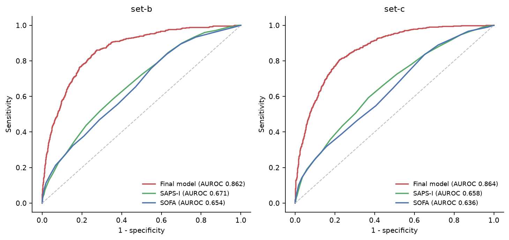
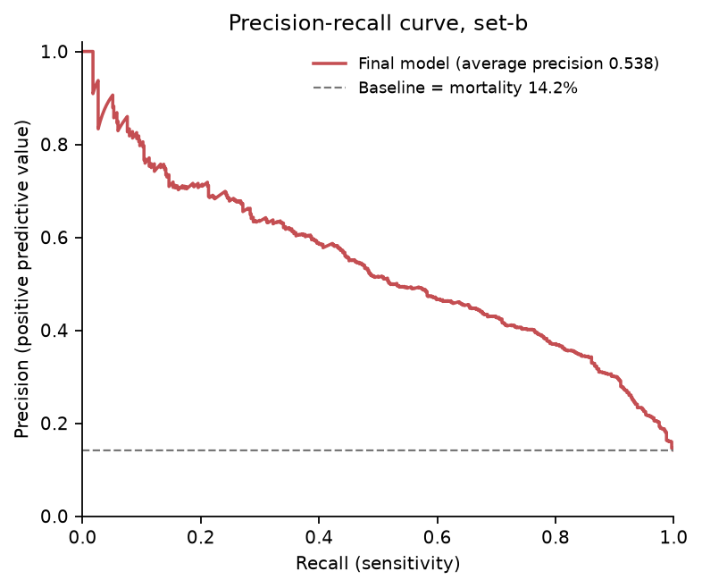
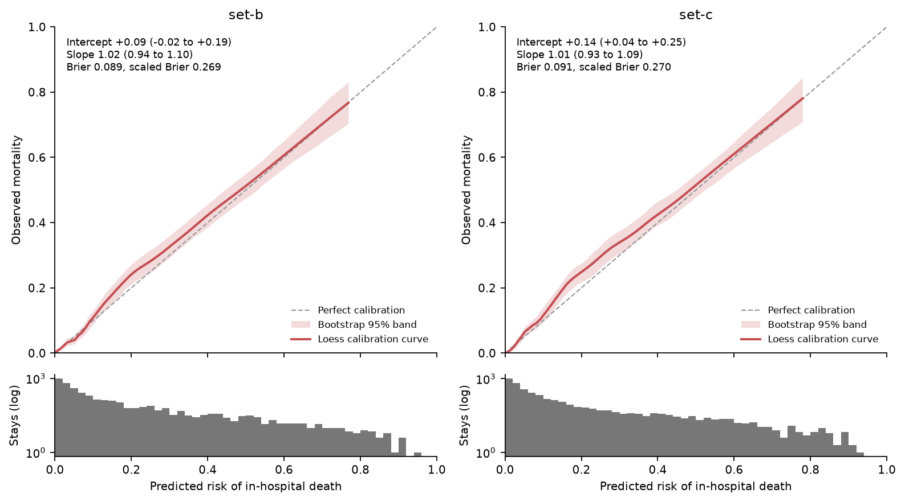
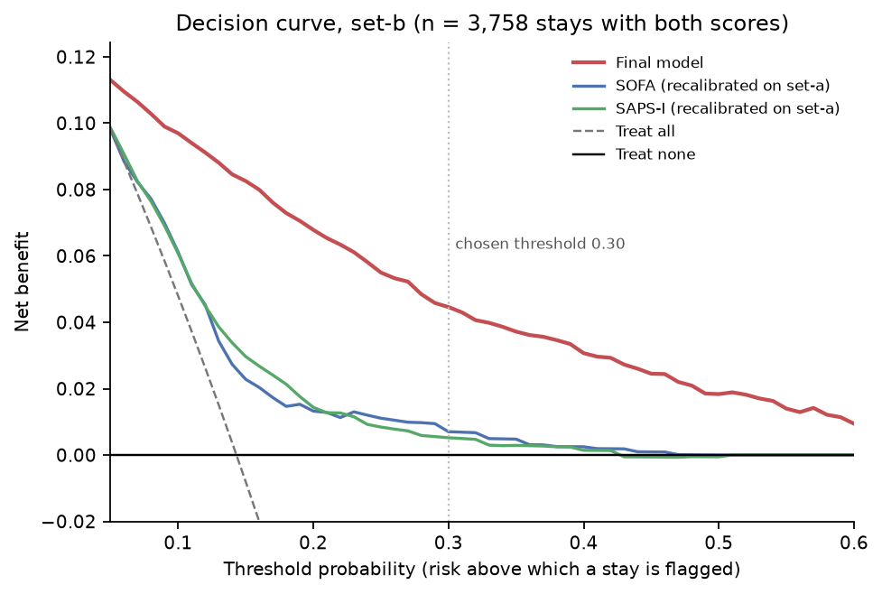
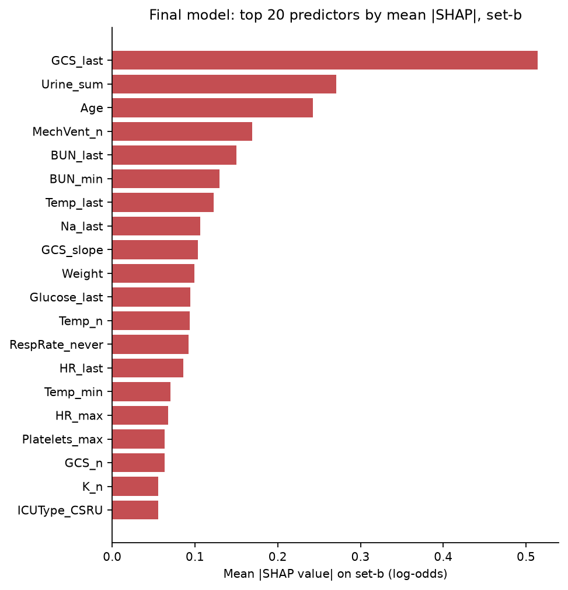
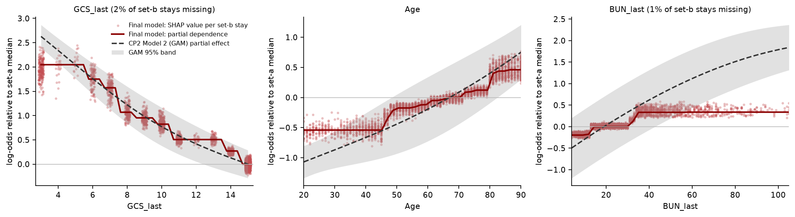

> This is the plain-Markdown copy of the Checkpoint 3 report, written by the same
> `pixi run --locked checkpoint3` command that renders `checkpoint3.html`. The HTML file is the
> version the checklist asks for; this file is the same text without code cells, so it reads
> start to finish in an editor or on the repository page. Tables are Markdown tables and the
> figures are the PNG files in this folder.


# Checkpoint 3: evaluating the final mortality model on set-b and set-c

**Junjie Cai (jc1206)**, BIOSTAT 707, Duke University
This notebook is the written report. Running `pixi run --locked checkpoint3` from this folder
executes it once and writes two readable versions: `output/checkpoint3.html` (the rendered
notebook, which is the format the checklist asks for) and `output/report.md` (the same text as
plain Markdown, without code cells). The run takes a few minutes on a laptop.

The model evaluated here is the **final model from Checkpoint 2**, a gradient-boosted tree
ensemble fitted on all 4,000 stays of set-a. It is loaded from
`../checkpoint2/output/cp2_final_model.joblib` and only applied. It is **not refitted or re-tuned**
on set-b or set-c. set-b and set-c are converted into modelling tables by the unchanged Checkpoint 2
code (`../checkpoint2/cp2_lib.py`). Data are read only from the repository's `data/` folder (set-a,
set-b, set-c and the three outcome files; `checkpoint3/data/` is used if present, otherwise `data/`
at the repository root). Apart from that, the notebook reads only the Checkpoint 2 outputs that the
checklist tells Checkpoint 3 to load (the saved final model and the out-of-fold predictions), and it
writes only to `output/`. Every path is relative.

## AI-Use Statement

**Tool.** I used Claude Code (Claude Opus 5.5), Anthropic's coding assistant, in VS Code. No other AI tools were used.

**What it was used for.** I used Claude Code as a programming and writing assistant. It reviewed my Checkpoint 2 code and report, wrote the evaluation code (`cp3_lib.py`, this notebook and `build_report.py`), configured the pixi environment, and drafted the report text, which I then reviewed and edited.

I set the task and its requirements (the Checkpoint 3 checklist), reviewed the analysis, checked the interpretation of the tables and figures, reviewed the assessments of the ten confidently misclassified stays in Section 7, and made the final decisions about what to include in the report.

**How the output was checked.** I personally verified the results through the following steps:

1. I checked that the data splits did not overlap, that each table contained the correct number of stays, and that the predictor variables matched the saved model.
2. I verified that the model reproduced the expected mean risk of 0.137 and checked the consistency of the SHAP values and GAM comparison results.
3. I compared the numerical results and statements in the report against the actual tables and figures and corrected any inconsistencies.
4. I ran the pixi task multiple times, including in a fresh repository clone, to check reproducibility.
5. I reviewed the complete report and figures and personally checked the Section 7 interpretations against the individual values in Table 11. I can explain the analysis, code, and conclusions during an oral review.

**Strengths and weaknesses.** Claude Code was useful for speeding up the coding, organising the evaluation pipeline, and making the report clearer. However, some of its initial interpretations were inaccurate. For example, it described the risk range of the model's under-prediction incorrectly, overstated the agreement between the final model and the GAM at high BUN (blood urea nitrogen) values, and misstated when the threshold had been selected. It also let a local file path into the report. These issues were found by checking the draft against the results and were corrected before submission. This showed me that AI-generated code and explanations must be verified, not accepted without review.

## 0. What is evaluated and how

The task is to predict in-hospital death from the first 48 hours of an intensive care unit (ICU)
stay. Checkpoint 2 is abbreviated CP2 in table headers. The report follows the checklist. Section 1
applies the model to set-b and set-c. Section 2
covers discrimination: the area under the receiver operating characteristic curve (AUROC) with
bootstrap 95% confidence intervals (CI), the comparison with SAPS-I (Simplified Acute Physiology
Score I) and SOFA (Sequential Organ Failure Assessment), the comparison with the cross-validation
(CV) estimate, and the precision-recall (PR) curve. Section 3 covers calibration: a flexible loess
calibration curve, the calibration intercept and slope, and the Brier score. Section 4 covers
clinical usefulness: decision curve analysis (DCA), a proposed threshold, and the 2012 challenge
Event 1 score. Section 5 presents the subgroups, section 6 the interpretation (SHAP, SHapley
Additive exPlanations, and partial dependence against the Checkpoint 2 GAM, generalised additive
model), section 7 the most confident errors, and section 8 the conclusions.

set-b plays the role of the primary test set and set-c serves as a second, independent test set.
The 2012 challenge kept set-c hidden and used it only for its final scores.

```text
pandas 3.0.6 | scikit-learn 1.9.1 | statsmodels 0.15.0 | shap 0.52.0
Data folder: checkpoint3/data/
```

## 1. Applying the Checkpoint 2 model to set-b and set-c (3.1)

The cell below does four things:

1. It loads the saved Checkpoint 2 bundle (the fitted model plus its ordered list of 124
   predictors) and prints the file's SHA-256 (Secure Hash Algorithm) fingerprint. That fingerprint identifies exactly
   which file was evaluated.
2. It runs the **same** Checkpoint 2 function, `cp2_lib.build_modeling_table`, on set-a, set-b and
   set-c. Cleaning (the `-1` codes, the units of FiO2, the fraction of inspired oxygen, height
   units, plausibility bounds), the 0 to 48
   hour summaries, the missingness indicators and the ICU-type dummies are therefore identical, and
   the predictor columns come out in the model's order. The code checks the order.
3. It checks that the three sets share no `RecordID`, that each table has one row per stay, and
   that set-b and set-c contain no predictor that set-a lacks (and none that set-a has but they
   lack).
4. It confirms that the loaded model is the one Checkpoint 2 fitted on set-a. Applied to set-a, it
   reproduces the mean risk printed in the Checkpoint 2 reload check, 0.137.

```text
Loaded ../checkpoint2/output/cp2_final_model.joblib (SHA-256 8e3d1c98c0ea2e8a...)
Model: HistGradientBoostingClassifier, 249 boosting iterations, 124 predictors, configuration {'learning_rate': 0.05, 'max_leaf_nodes': 7, 'min_samples_leaf': 20}
```

```text
Set-a check: mean predicted risk 0.137 (Checkpoint 2 reload check: 0.137)
```

**Table 1. Stays and deaths in each set, with the final model's mean predicted risk**

| Set | ICU stays | In-hospital deaths | Deaths (%) | Raw measurements | SAPS-I missing | SOFA missing | Mean predicted risk (%) |
| --- | --- | --- | --- | --- | --- | --- | --- |
| set-a (training, CP2) | 4,000 | 554 | 13.85 | 1,757,980 | 190 | 144 | 13.65 |
| set-b (test) | 4,000 | 568 | 14.20 | 1,762,535 | 162 | 137 | 13.44 |
| set-c (test) | 4,000 | 585 | 14.62 | 1,765,303 | 166 | 122 | 13.36 |

Table 1 lists the stay and death counts that the checklist asks for. **set-b has 4,000 stays and
568 in-hospital deaths (14.2%). set-c has 4,000 stays and 585 deaths (14.6%).** set-a had 13.9%. The
mean predicted risk is about 13.4% in both test sets, slightly below the observed mortality. Section 3
looks at that gap in detail.

**Preprocessing comes only from set-a.** The final model is scikit-learn's histogram
gradient-boosting classifier. As Checkpoint 2 explained, it was given missing values directly, so
there is no imputer and no scaler to re-estimate. The only fitted preprocessing it contains is
internal: the bin edges used to discretise each predictor, and the side of each split to which a
missing value is sent. Both were learned on set-a, are stored inside the saved model, and are
applied to set-b and set-c unchanged. Nothing in this notebook calls `fit` on the final model. The
SAPS-I and SOFA probability maps used in section 4, and the 0.30 threshold, were also estimated
on set-a only.

```text
Wrote output/cp3_predictions_bc.csv (one row per set-b and set-c stay)
```

## 2. Discrimination (3.2)

The AUROC is computed for each set separately. Its 95% CI comes from 2,000 bootstrap resamples of
stays (percentile method, seed 707). SAPS-I and SOFA are scored on the same sets. As in Checkpoint 2,
a stay whose score is missing (coded `-1`) is skipped only in that score's row. In Table 3, SD is
the standard deviation of the AUROC across the five Checkpoint 2 folds.

**Table 2. AUROC with bootstrap 95% CI on set-b and set-c**

| Set | Predictor | Stays scored | AUROC | 95% CI lower | 95% CI upper |
| --- | --- | --- | --- | --- | --- |
| set-b | Final model (gradient boosting) | 4,000 | 0.862 | 0.845 | 0.877 |
| set-b | SAPS-I | 3,838 | 0.671 | 0.646 | 0.695 |
| set-b | SOFA | 3,863 | 0.654 | 0.631 | 0.678 |
| set-c | Final model (gradient boosting) | 4,000 | 0.864 | 0.849 | 0.878 |
| set-c | SAPS-I | 3,834 | 0.658 | 0.633 | 0.681 |
| set-c | SOFA | 3,878 | 0.636 | 0.611 | 0.660 |

**Table 3. Checkpoint 2 cross-validated AUROC against the AUROC on set-b and set-c**

| Predictor | CP2 CV AUROC, mean | CP2 CV AUROC, SD | set-b AUROC (95% CI) | set-c AUROC (95% CI) | set-b minus CV mean | set-c minus CV mean |
| --- | --- | --- | --- | --- | --- | --- |
| Final model (gradient boosting) | 0.851 | 0.025 | 0.862 (0.845 to 0.877) | 0.864 (0.849 to 0.878) | +0.011 | +0.013 |
| SAPS-I | 0.649 | 0.038 | 0.671 (0.646 to 0.695) | 0.658 (0.633 to 0.681) | +0.022 | +0.008 |
| SOFA | 0.623 | 0.012 | 0.654 (0.631 to 0.678) | 0.636 (0.611 to 0.660) | +0.031 | +0.012 |

```text
Final model, set-b minus set-c AUROC: -0.002 (95% CI -0.024 to +0.019; z = -0.22, two-sided p = 0.82)
```

Table 2 shows that the final model discriminates well in both test sets, with an AUROC of about
0.86. Its intervals lie far above those of SAPS-I (about 0.66 to 0.67) and SOFA (about 0.64 to
0.65), and none of the intervals overlap. The gap of roughly 0.20 seen in Checkpoint 2 therefore
holds on data the model never saw.

**Was the CV estimate optimistic?** No. Table 3 shows that the set-b and set-c AUROCs are about
0.01 *above* the Checkpoint 2 CV mean (0.851). That difference is less than half of the
fold-to-fold SD (0.025), and the CV mean lies inside both test-set intervals. I expected a small
drop, because the same set-a data were used both to rank the configurations and to choose the
model. Two things explain why there was none. (i) The CV models were trained on 3,200 stays, while
the final model was trained on all 4,000. (ii) The test sets appear slightly easier to rank: SAPS-I
and SOFA, which are fixed scores and were not fitted to set-a at all, also score 0.01 to 0.03
higher on set-b and set-c than on set-a. The optimism that the selection process could have
introduced is therefore too small to see beside the sampling variation.

**Is the difference between set-b and set-c larger than expected?** No. The two AUROCs differ by
less than 0.01, and the bootstrap 95% CI for the difference (printed above) is centred close to
zero and contains it. That is the result expected when two random samples are drawn from the same
population of stays.



**Figure 1. ROC curves on set-b (left) and set-c (right) for the final model, SAPS-I and SOFA.**
The final model's curve lies above both scores at every specificity. The two panels are almost
identical, which is the visual version of the set-b versus set-c comparison above.



```text
Average precision on set-b 0.538 against a no-skill baseline of 0.142 (3.8 times the baseline)
```

**Figure 2. Precision-recall curve of the final model on set-b.** The dashed line is the
mortality rate (14.2%), which is the precision that a model with no skill would achieve at every
recall. The curve stays well above that line. At a recall of about 50%, roughly one flagged
patient in two dies. Precision falls steadily as recall rises, but even at 90% recall it is still
about 0.30, about twice the baseline.

The PR curve is informative here *because* deaths are relatively rare. The ROC curve's x-axis is
the false-positive rate, whose denominator is the 3,432 survivors. Flagging an extra 100 survivors
therefore moves the ROC curve by less than 0.03 and looks cheap. Precision is computed among the
flagged patients only, so the same 100 false alarms visibly lower the curve. Precision is the
quantity a clinician experiences ("of the patients this tool flags, how many actually die?"), so
it shows the cost of false alarms that the AUROC hides when the outcome is uncommon.

## 3. Calibration (3.3)

Calibration is assessed by the method recommended in *Evaluating clinical prediction models,
part 1*: a flexible calibration curve plus the calibration intercept and slope. I do not rely on
the Hosmer-Lemeshow test.

* **Flexible curve.** A loess smoother (statsmodels `lowess`, span 0.4, no robustness iterations,
  which would otherwise treat the rare deaths as outliers) estimates observed mortality as a
  function of predicted risk. The 95% band comes from 200 bootstrap resamples. The histogram under
  each curve shows how many stays lie at each predicted risk, on a log scale.
* **Calibration intercept** (calibration-in-the-large): a logistic regression of the outcome on an
  intercept only, with logit(predicted risk) as an offset. The ideal value is 0. A value above 0
  means the model under-predicts on average.
* **Calibration slope**: the coefficient from a logistic regression of the outcome on
  logit(predicted risk). The ideal value is 1. Below 1, predictions are too extreme (overfitting);
  above 1, they are too conservative.
* **Brier score**: the mean squared difference between predicted risk and outcome. The **scaled
  Brier** is 1 − Brier / Brier of a model that predicts the mortality rate for everyone, so 0 means
  no better than that model and 1 means perfect.

**Table 4. Calibration of the final model on set-b and set-c**

| Set | Observed mortality (%) | Mean predicted risk (%) | Calibration intercept (95% CI) | Calibration slope (95% CI) | Brier score | Brier, null model | Scaled Brier |
| --- | --- | --- | --- | --- | --- | --- | --- |
| set-b | 14.20 | 13.44 | +0.087 (-0.017 to +0.191) | 1.023 (0.941 to 1.105) | 0.0890 | 0.1218 | 0.269 |
| set-c | 14.62 | 13.36 | +0.145 (+0.042 to +0.248) | 1.013 (0.934 to 1.092) | 0.0912 | 0.1249 | 0.270 |



**Figure 3. Flexible (loess) calibration curves on set-b (left) and set-c (right).** The red
line is observed mortality as a function of predicted risk, the shaded band is the bootstrap 95%
interval, and the dashed diagonal is perfect calibration. The histograms below (log scale) show
that most stays have predicted risks under 20%. Above 60% the curve rests on only about 140 stays
per set, which is why the band widens there, and the curve stops at the 99th percentile of
predicted risk.

**Table 5. Mean predicted risk against observed mortality within bands of predicted risk**

| Set | Predicted-risk band | Stays | Deaths | Mean predicted (%) | Observed (%) |
| --- | --- | --- | --- | --- | --- |
| set-b | 0% to 5% | 1889 | 39 | 2.1 | 2.1 |
| set-b | 5% to 10% | 644 | 40 | 7.2 | 6.2 |
| set-b | 10% to 20% | 570 | 100 | 14.4 | 17.5 |
| set-b | 20% to 40% | 499 | 158 | 28.4 | 31.7 |
| set-b | 40% to 60% | 255 | 130 | 48.7 | 51.0 |
| set-b | 60% to 100% | 143 | 101 | 72.1 | 70.6 |
| set-c | 0% to 5% | 1915 | 37 | 2.1 | 1.9 |
| set-c | 5% to 10% | 656 | 56 | 7.2 | 8.5 |
| set-c | 10% to 20% | 558 | 102 | 14.3 | 18.3 |
| set-c | 20% to 40% | 461 | 155 | 28.8 | 33.6 |
| set-c | 40% to 60% | 269 | 135 | 49.1 | 50.2 |
| set-c | 60% to 100% | 141 | 100 | 72.3 | 70.9 |

**How the curve, intercept and slope fit together.** The calibration slope is close to 1 in both
sets (about 1.02, with intervals that contain 1), so the spread of the predictions is right: they
are neither too extreme nor too timid, and the model shows no sign of overfitting. The intercept is
slightly positive, about +0.09 on set-b (interval includes 0) and about +0.15 on set-c (interval
just excludes 0). That means a small, uniform **under-prediction**: observed mortality is about 1
percentage point above the mean prediction (14.2% against 13.4% on set-b, 14.6% against 13.4% on
set-c). The curve and Table 5 show where the gap is. Below a predicted risk of 10%, where about
two thirds of the patients are, predictions and observations agree to within about one percentage
point. Between 10% and 40%, the curve lies just above the diagonal: observed mortality is about 3
percentage points above the mean prediction on set-b and 4 to 5 points above it on set-c (for
example 33.6% observed against 28.8% predicted in the 20% to 40% band of set-c). Above 40%, the
curve returns to the diagonal within a wide band. The set-c intercept excludes 0, but the overall
error is about one percentage point of absolute risk. It is the kind of
difference a simple intercept update could correct for a new site, and it does not threaten the
use proposed in section 4.

The **Brier score** is about 0.09 in both sets, against about 0.12 to 0.125 for a model that
predicts the mortality rate for everyone. The scaled Brier of 0.27 means the model removes about a
quarter of the squared prediction error that remains when only the mortality rate is known. That
is typical for in-hospital mortality prediction, where many deaths follow events after hour 48.

## 4. Clinical usefulness (3.4)

**Proposed use.** At the end of the first 48 hours in the ICU, the model would flag every patient
whose predicted risk of in-hospital death is **at least 0.30**. The flag would trigger a structured
**goals-of-care conversation** with the patient or family, led by the attending physician, within
the next 24 hours, with a palliative-care consult offered. The flag does not withdraw or ration
treatment. It makes sure that an important conversation is not left until a crisis.

**Why 0.30.** A threshold probability *p* states how many false alarms one accepts per true case:
at 0.30, the odds are 0.30/0.70, so about 2.3 conversations with patients who survive are judged
acceptable for each conversation with a patient who dies. A goals-of-care conversation has little
potential for harm, but it takes senior clinician time and can distress families. The threshold
should therefore be well above the 14% base rate, but not so high that most dying patients are
missed. The threshold is set by a rule that uses **set-a only**, so set-b and set-c play no part
in choosing it. Table 6 uses Checkpoint 2's out-of-fold predictions, and 0.30 is the round number
closest to the threshold that maximises the challenge's Event 1 score, min(Se, PPV), on set-a
(0.29). Se is the sensitivity and PPV the positive predictive value, the share of flagged patients
who die.

**Table 6. Choosing the threshold on set-a (Checkpoint 2 out-of-fold predictions, not set-b)**

| Threshold | Flagged per 100 | Sensitivity | PPV | Event 1 score |
| --- | --- | --- | --- | --- |
| 0.20 | 20.8 | 0.621 | 0.412 | 0.412 |
| 0.25 | 16.7 | 0.552 | 0.459 | 0.459 |
| 0.29 | 14.1 | 0.493 | 0.484 | 0.484 |
| 0.30 | 13.5 | 0.480 | 0.492 | 0.480 |
| 0.35 | 10.7 | 0.417 | 0.540 | 0.417 |
| 0.40 | 8.6 | 0.348 | 0.564 | 0.348 |

```text
Threshold maximising min(sensitivity, PPV) on set-a out-of-fold predictions: 0.29; fixed threshold used below: 0.30
```

**Decision curve.** The DCA compares four strategies over thresholds from 0.05 to 0.60: the final
model, SOFA, SAPS-I, *treat all* (a conversation for everyone) and *treat none*. Net benefit is
TP/n − FP/n × *p*/(1 − *p*), where TP and FP are the numbers of true and false positives. It counts
true positives and charges false positives at the exchange rate that the threshold implies. SOFA and
SAPS-I are integer scores, not probabilities, so each was first turned into a risk by a logistic
regression of death on the score **fitted on set-a**. A DCA needs a common population, so set-b is
restricted to the stays where both scores are available (n is printed below). The model's net
benefit on all 4,000 stays is almost the same.

```text
Set-a maps: logit(risk) = -2.721 + 0.124 x SOFA; logit(risk) = -3.564 + 0.109 x SAPS-I
```



```text
Net benefit at 0.30: final model 0.0446 (all 4,000 stays: 0.0432), SOFA 0.0070, SAPS-I 0.0052, treat all -0.2241, treat none 0
i.e. 4.5 net true positives per 100 patients for the model, 0.7 for SOFA
```

**Figure 4. Decision curve on set-b.** Net benefit (y-axis) against the threshold probability
(x-axis) for the final model (red), SOFA and SAPS-I (both turned into risks on set-a), treat all
(dashed) and treat none (black, at zero). The dotted vertical line marks the chosen threshold of
0.30.

Between about 0.05 and 0.60, the final model has the highest net benefit of all strategies.
*Treat all* drops below zero once the threshold exceeds the 14% base rate. SOFA and SAPS-I help a
little at low thresholds, but above about 0.25 their net benefit is close to that of treat none,
because their recalibrated risks seldom reach such values (only about 2% of set-b stays have a
SOFA-based risk of 0.30 or more). At 0.30, therefore, using SOFA would be little better than not
flagging anyone. At that threshold the model's net benefit is about 0.045, which corresponds to
about 4.5 net true positives per 100 patients. That is the number of dying patients correctly
flagged per 100 after the false alarms have been charged at the 0.30 exchange rate.

**Table 7. The final model at the pre-specified threshold of 0.30**

| Set | Threshold | Flagged per 100 patients | Flagged | True positives | False positives | Sensitivity | Specificity | PPV | Event 1 score = min(Se, PPV) |
| --- | --- | --- | --- | --- | --- | --- | --- | --- | --- |
| set-b | 0.30 | 14.3 | 573 | 293 | 280 | 0.516 | 0.918 | 0.511 | 0.511 |
| set-c | 0.30 | 14.9 | 596 | 310 | 286 | 0.530 | 0.916 | 0.520 | 0.520 |

Table 7 shows the model at the proposed threshold. On set-b it flags **about 14 patients per
100**, with a **sensitivity of about 0.52** (it catches about half of the patients who will die in
hospital) and a **positive predictive value (PPV) of about 0.51** (about half of the flagged patients
die). In a 20-bed ICU admitting about 100 patients a month, that is about 14 extra goals-of-care
conversations a month, of which about 7 involve a patient who will die in hospital. set-c gives
nearly the same figures.

**2012 challenge Event 1 score.** The score is min(Se, PPV). At 0.30 it is **0.511 on set-b and
0.520 on set-c** (Table 7). For context, the official top-ten list distributed with the challenge
data (`top-ten-event1.txt`) ranges from 0.465 to 0.531. This model, evaluated at a threshold fixed
on set-a, therefore performs at the level of the challenge's leading entries, although I did not
optimise for the score.

## 5. Subgroups (3.5)

The subgroups are computed on set-b by age group (under 50, 50 to 64, 65 to 79, 80 and over), sex
and ICU type: CCU (coronary care unit), CSRU (cardiac surgery recovery unit), MICU (medical ICU) and
SICU (surgical ICU). For each subgroup Table 8 gives the number of stays and deaths, observed mortality,
mean predicted risk, the AUROC with a bootstrap 95% CI (1,000 resamples), and the calibration
intercept (calibration-in-the-large) with its 95% CI. Sex is missing for 5 stays, which are left
out of the sex rows.

**Table 8. Discrimination and calibration-in-the-large by subgroup, set-b**

| Subgroup | Level | Stays | Deaths | Observed mortality (%) | Mean predicted risk (%) | AUROC | AUROC 2.5% | AUROC 97.5% | Calibration intercept | Intercept 2.5% | Intercept 97.5% |
| --- | --- | --- | --- | --- | --- | --- | --- | --- | --- | --- | --- |
| Age group | < 50 | 775 | 68 | 8.8 | 8.6 | 0.900 | 0.865 | 0.930 | +0.03 | -0.26 | +0.31 |
| Age group | 50 to 64 | 1,024 | 109 | 10.6 | 10.9 | 0.878 | 0.836 | 0.912 | -0.03 | -0.26 | +0.20 |
| Age group | 65 to 79 | 1,328 | 196 | 14.8 | 13.2 | 0.831 | 0.797 | 0.859 | +0.17 | -0.00 | +0.35 |
| Age group | >= 80 | 873 | 195 | 22.3 | 21.1 | 0.834 | 0.798 | 0.865 | +0.10 | -0.09 | +0.29 |
| Sex | Female | 1,742 | 259 | 14.9 | 14.8 | 0.849 | 0.825 | 0.873 | +0.01 | -0.15 | +0.16 |
| Sex | Male | 2,253 | 309 | 13.7 | 12.4 | 0.872 | 0.850 | 0.892 | +0.16 | +0.02 | +0.30 |
| ICU type | CCU | 590 | 72 | 12.2 | 12.8 | 0.844 | 0.792 | 0.891 | -0.07 | -0.35 | +0.22 |
| ICU type | CSRU | 782 | 34 | 4.3 | 5.0 | 0.868 | 0.789 | 0.936 | -0.19 | -0.58 | +0.20 |
| ICU type | MICU | 1,436 | 286 | 19.9 | 18.3 | 0.810 | 0.781 | 0.836 | +0.14 | -0.01 | +0.29 |
| ICU type | SICU | 1,192 | 176 | 14.8 | 13.5 | 0.882 | 0.855 | 0.908 | +0.14 | -0.04 | +0.33 |

```text
Subgroups compared: 10; with 10 calibration intervals at 95%, about 0.5 would exclude zero by chance alone even if the model were equally calibrated everywhere.
```

**Which differences are large enough to matter?** Table 8 makes ten comparisons, and several
subgroups are small (CSRU has only 34 deaths, under-50s 68), so any single difference should be
judged against its interval and against the number of comparisons.

* **Age.** The AUROC falls from about 0.90 under 50 to about 0.83 at 65 and over, and the
  intervals for the youngest and the two oldest groups do not overlap. This is the one pattern I
  consider real. It is also expected: age is itself a strong predictor, and within an older band
  the patients are more alike in the rest of their physiology, so ranking them is harder. Mean
  predicted risk follows observed mortality closely in every age group (all four intercept
  intervals contain 0, the 65 to 79 group's only just).
* **ICU type.** The AUROC ranges from about 0.81 in the MICU (medical ICU) to about 0.88 in the
  SICU (surgical ICU). The MICU interval (0.78 to 0.84) lies just below the SICU interval (0.86 to
  0.91) and does not overlap it. Medical
  patients are a mixed group (sepsis, respiratory failure, cancer), and their deaths depend more on
  the underlying disease, which the 48-hour physiology captures less well. The CSRU (cardiac
  surgery recovery unit) AUROC rests on 34 deaths, and its very wide interval (about 0.79 to 0.94)
  allows no conclusion. All four ICU intercept intervals contain 0.
* **Sex.** The AUROCs for women and men (0.85 and 0.87) have overlapping intervals. Men are
  slightly under-predicted (intercept +0.16, interval just above 0; observed 13.7% against a
  predicted 12.4%). It is the only one of the ten intercept intervals that excludes zero, and about
  0.5 such intervals are expected by chance alone, so I report it as a pattern to monitor, not as
  evidence of a sex-specific miscalibration.

In short, the model works in every subgroup, with an AUROC of at least 0.81 everywhere and no
clinically important miscalibration. Ranking is weaker among older and medical-ICU patients, and
that is where the threshold-based flag will miss the largest share of deaths.

## 6. Interpretation (3.6)

For the tree ensemble I use **SHAP values**, which are exact for tree models (`shap.TreeExplainer`).
On the log-odds scale they add up, for each stay, to the model's prediction minus the average
prediction. **Permutation importance** on set-b, the drop in AUROC when one predictor is shuffled
(5 repeats), serves as a second, model-agnostic check.



**Table 9. Top 15 predictors by mean |SHAP| on set-b, with permutation importance**

| predictor | mean \|SHAP\| | AUROC drop when shuffled | SD over repeats | Permutation rank |
| --- | --- | --- | --- | --- |
| GCS_last | 0.514 | 0.0748 | 0.0026 | 1 |
| Urine_sum | 0.271 | 0.0093 | 0.0009 | 3 |
| Age | 0.242 | 0.0178 | 0.0023 | 2 |
| MechVent_n | 0.169 | 0.0027 | 0.0015 | 10 |
| BUN_last | 0.150 | 0.0042 | 0.0016 | 5 |
| BUN_min | 0.129 | 0.0025 | 0.0010 | 12 |
| Temp_last | 0.122 | 0.0020 | 0.0015 | 15 |
| Na_last | 0.107 | 0.0013 | 0.0012 | 18 |
| GCS_slope | 0.103 | 0.0026 | 0.0006 | 11 |
| Weight | 0.099 | 0.0032 | 0.0007 | 7 |
| Glucose_last | 0.094 | 0.0022 | 0.0006 | 14 |
| Temp_n | 0.094 | 0.0001 | 0.0005 | 57 |
| RespRate_never | 0.092 | 0.0051 | 0.0008 | 4 |
| HR_last | 0.086 | 0.0028 | 0.0006 | 8 |
| Temp_min | 0.070 | 0.0003 | 0.0006 | 40 |

**Figure 5. The 20 predictors with the largest mean absolute SHAP value on set-b.** A bar is the
average size of that predictor's push on the log-odds of death, in either direction.

The ranking is clinically sensible and agrees with Checkpoint 2. **`GCS_last`, the last Glasgow
Coma Scale value, dominates.** Its mean |SHAP| is about twice that of the next predictor, and
shuffling it lowers the AUROC by about 0.07, far more than any other predictor. Next come
**`Urine_sum`** (total recorded urine output), **`Age`**, **`MechVent_n`** (number of
mechanical-ventilation records), blood urea nitrogen (BUN, last and minimum value), the last temperature and sodium, the
GCS trend and weight. Permutation importance ranks the same predictors near the top: GCS, age,
urine output, `RespRate_never` and BUN. They also matched the stable core of the Checkpoint 2
LASSO. Beyond the top 10 the importance is spread thinly over many correlated summaries. That is
why no single laboratory value beyond these should be singled out.

**Partial dependence compared with the Checkpoint 2 GAM.** For three predictors that are both
important here and plotted in Checkpoint 2 (`GCS_last`, `Age`, `BUN_last`), Figure 6 overlays
three curves: (i) the SHAP value of each set-b stay (dots); (ii) the final model's partial
dependence (solid line, the average log-odds over 800 set-b stays as the predictor is varied); and
(iii) the Checkpoint 2 Model 2 GAM partial effect with its 95% band (dashed). All three are centred
at the predictor's set-a median. To draw curve (iii), the GAM is refitted on set-a by the same
Checkpoint 2 function, `refit_final(..., "gam", ...)`. That reproduces Checkpoint 2's Figure 2
model and is not the final model. Neither set-b nor set-c enters that fit.

```text
Checkpoint 2 Model 2 refitted on set-a for the comparison (lam = 0.6)
```



```text
GAM odds ratios: GCS 7 vs 15 = 4.40, BUN 51 vs 19 = 2.47 (Checkpoint 2 Table 12: 4.40 and 2.47)
```

**Table 10. Partial effects (log-odds relative to the set-a median) at set-a percentiles 1, 10, 50, 90 and 99**

| predictor | set-a percentile | value | Final model partial dependence (log-odds) | GAM partial effect (log-odds) |
| --- | --- | --- | --- | --- |
| GCS_last | 1 | 3.0 | 2.047218 | +2.63 |
| GCS_last | 10 | 7.0 | 1.570821 | +1.48 |
| GCS_last | 50 | 15.0 | 0.000000 | +0.00 |
| Age | 1 | 20.0 | -0.541455 | -1.07 |
| Age | 10 | 40.0 | -0.541455 | -0.66 |
| Age | 50 | 67.0 | 0.000000 | +0.00 |
| Age | 90 | 85.0 | 0.438035 | +0.57 |
| Age | 99 | 90.0 | 0.460332 | +0.75 |
| BUN_last | 1 | 4.0 | -0.196136 | -0.50 |
| BUN_last | 10 | 8.0 | -0.196136 | -0.36 |
| BUN_last | 50 | 19.0 | 0.000000 | +0.00 |
| BUN_last | 90 | 51.0 | 0.332576 | +0.91 |
| BUN_last | 99 | 105.0 | 0.337122 | +1.84 |

**Figure 6. Final model against the Checkpoint 2 GAM for `GCS_last`, `Age` and `BUN_last`.** Red
dots are set-b SHAP values, the dark red line is the final model's partial dependence, and the
dashed black line with its grey band is the GAM partial effect. All are on the log-odds scale
relative to the set-a median.

Table 10 gives the same curves as numbers at set-a percentiles. The refitted GAM is the Checkpoint 2
model: its values reproduce Checkpoint 2's Table 12 (for example exp(1.48) = 4.40, the odds ratio at
a GCS of 7, and exp(0.91) = 2.47 at a BUN of 51 mg/dL).

* **GCS: close agreement.** Both curves rise almost steadily as the last GCS falls from 15 to 3,
  to about +2.0 log-odds for the final model and +2.6 for the GAM at GCS 3 (an odds ratio of about
  8 to 14 against a GCS of 15). The tree ensemble's steps follow the GAM's curve and stay inside its
  95% band over almost the whole range, apart from a plateau below a GCS of about 5.
* **Age: same direction, different shape.** The GAM is close to linear. The final model is flat
  below about 45, rises in steps, and jumps once more at about 80. Its total rise from 20 to 90
  years (about 1.0 log-odds) is smaller than the GAM's (about 1.8), but the curve stays mostly
  inside the GAM's band.
* **BUN: agreement up to about 35 mg/dL, then a real difference.** Both rise from low to normal
  values. Above about 35 mg/dL the final model's curve is flat (about +0.3), while the GAM keeps
  rising to about +1.8 at 100 mg/dL. The GAM's curve is the more plausible clinically. The tree
  ensemble spreads the renal signal across several correlated predictors (`BUN_min`, which is 6th
  by SHAP, `BUN_slope` and the creatinine summaries), so the partial dependence for `BUN_last`
  alone shows only part of the effect. Trees also cannot extrapolate beyond their last split, and
  few patients have a BUN above 60.

The vertical spread of the SHAP dots at a given value shows interactions and correlated
predictors that an additive GAM cannot represent. Overall, the two model classes agree on the
direction of all three effects and on the shape of the dominant one (GCS). Where they disagree
(very high BUN), the reason is how the tree ensemble shares the effect among correlated
predictors, not a contradictory finding.

**Why the important predictors must not be read causally.** The model predicts death from what
was *recorded* in the first 48 hours. Many records reflect the care given and the decisions made,
not only the patient's biology. Examples from this model:

* **`MechVent_n`** is the fourth most important predictor by SHAP. In the low-risk deaths in
  section 7, a *small* count (4 to 6 ventilation records) pushes the risk *down*. Those are mostly
  fast-track cardiac surgery patients who were taken off the ventilator early. The model has learned that being taken off the
  ventilator early is a marker of a good course. It would be absurd to conclude that ventilating
  fewer patients would save lives.
* **`RespRate_never`** raises predicted risk (LASSO coefficient +0.25 in Checkpoint 2, and in the
  permutation top five here). Respiratory rate is missing from the records of most ventilated
  patients, so the indicator mostly flags ventilation and unit documentation habits. Recording a
  respiratory rate cannot lower anyone's risk.
* **`Urine_sum`** is the total of the urine volumes recorded. It depends on the number of hours
  with a recorded volume (catheter in place, nurse charting) as well as on kidney function. A low
  total partly means "few recorded hours".
* **`GCS_last`** is measured under sedation in ventilated patients, so a low score partly reflects
  the sedation policy. Lightening sedation to raise the number would not change the prognosis.

These predictors are useful for *prediction*, because they are recorded by hour 48 in the same way
in set-b and set-c, but they carry no causal effect. A causal question (for example "does early
extubation reduce mortality?") would need a design that deals with confounding by indication, which
this model does not.

## 7. The most confident errors (3.7)

Table 11 lists the five set-b **survivors with the highest predicted risk** and the five set-b
**deaths with the lowest predicted risk**. For each stay, the "drivers" column gives the four
predictors with the largest SHAP values, written as value (contribution in log-odds). The table also
gives the number of the 124 predictors that are missing, the SAPS-I and SOFA scores, and my
judgement of where the error comes from, which was checked against each stay's raw values. The code
checks that the stays shown are the ones that were reviewed. Abbreviations in the table: y, years;
HR, heart rate; HCO3, serum bicarbonate; WBC, white blood cell count; PaO2, arterial oxygen
partial pressure; FiO2, fraction of inspired oxygen; C, degrees Celsius.

```text
All ten stays were reviewed.
```

**Table 11. The five most confident false alarms and the five most confident misses on set-b**

| Error type | RecordID | Predicted risk | ICU | Age | SAPS-I | SOFA | Predictors missing | Top drivers: value (SHAP log-odds) | Source of error | Why |
| --- | --- | --- | --- | --- | --- | --- | --- | --- | --- | --- |
| Survivor, highest risk | 148302 | 0.864 | CCU | 83 | 24 | 15 | 0 | GCS_last=6 (+1.50); GCS_max=6 (+0.61); Age=83 (+0.39); HR_max=177 (+0.34) | Information not in the data | CCU, 83 y, last GCS 6, HR up to 177, pH 7.24, HCO3 13, platelets 72, ventilated; SOFA 15. Genuinely critically ill; the high risk is reasonable and survival depended on the response to treatment after hour 48. |
| Survivor, highest risk | 150779 | 0.839 | CCU | 77 | — | 5 | 38 | Temp_last=34 (+0.71); Urine_sum=492 (+0.56); Temp_min=33 (+0.32); BUN_last=119 (+0.31) | Data problem | 38 of 124 predictors missing (no blood gas, invasive arterial pressure or ventilation record); urine total 492 mL comes from only 15 recorded hours; temperature 33 to 34 C in an awake patient (GCS 14) suggests therapeutic cooling or a probe error. The sparse, partly implausible record drives the risk. |
| Survivor, highest risk | 147053 | 0.838 | MICU | 79 | 27 | 14 | 1 | GCS_last=6 (+1.11); Urine_sum=2130 (+0.34); BUN_last=40 (+0.23); NISysABP_max=91 (+0.22) | Information not in the data | MICU, 79 y, GCS 6, lowest systolic 53 mmHg, lactate 7.8, HCO3 7, platelets 50; SOFA 14. A severe shock picture; the model is right to call this high risk. |
| Survivor, highest risk | 150629 | 0.795 | MICU | 76 | 17 | 15 | 0 | GCS_last=7 (+1.16); Urine_sum=1533 (+0.53); HR_last=128 (+0.38); NISysABP_last=79 (+0.24) | Information not in the data | MICU, 76 y, GCS 7, HR up to 145, lowest systolic 60, lactate 6.0, last FiO2 0.85, lowest PaO2 52; SOFA 15. Severe multi-organ failure; survival is not predictable from 48 h of data. |
| Survivor, highest risk | 148066 | 0.786 | SICU | 90 | 20 | 5 | 19 | GCS_last=7 (+1.12); Age=90 (+0.53); Urine_sum=895 (+0.41); HR_last=118 (+0.34) | Data problem (GCS under sedation) and model | SICU, 90 y, ventilated, last GCS 7 (likely sedated), 19 predictors missing, no lactate or arterial pressure. Age and a sedated GCS add up; the rest of the physiology (BUN 15, pH 7.45, PaO2 187) is reassuring. |
| Death, lowest risk | 151006 | 0.005 | SICU | 62 | 19 | 12 | 0 | MechVent_n=5 (-0.51); GCS_last=15 (-0.44); Urine_sum=5132 (-0.37); GCS_slope=0.25 (-0.35) | Model, plus information not in the data | SICU, 62 y, extubated early (5 ventilation records), GCS recovered from 3 to 15, urine 5.1 L. Fast-track pattern outweighed SOFA 12, lactate 3.1 and lowest systolic 76; the death occurred after a good first 48 h. |
| Death, lowest risk | 143448 | 0.005 | CSRU | 76 | 18 | 12 | 12 | MechVent_n=6 (-0.52); GCS_last=15 (-0.41); GCS_slope=0.38 (-0.31); Temp_n=38 (-0.18) | Information not in the data | CSRU, 76 y, routine post-cardiac-surgery course: only 6 ventilation records (early extubation), GCS 15, urine 4.2 L, normal BUN. Nothing in hours 0 to 48 predicts the death; a later complication is the likely cause. |
| Death, lowest risk | 150189 | 0.010 | CSRU | 68 | 19 | 14 | 13 | MechVent_n=4 (-0.53); GCS_last=15 (-0.37); BUN_last=43 (+0.32); Urine_sum=4738 (-0.30) | Information not in the data | CSRU, 68 y, early extubation and GCS 15 outweigh BUN 43, creatinine 2.1 and platelets 69 (which do push the risk up). Mostly a later complication; the renal signal is under-weighted. |
| Death, lowest risk | 152569 | 0.010 | CSRU | 79 | 11 | 3 | 5 | MechVent_n=5 (-0.54); GCS_last=15 (-0.45); Temp_n=42 (-0.26); Urine_sum=3172 (-0.24) | Information not in the data | CSRU, 79 y, unremarkable course in every recorded variable (GCS 15 throughout, HR at most 88, SOFA 3). No signal to learn from in the 48 h data. |
| Death, lowest risk | 146206 | 0.010 | CSRU | 71 | 24 | 6 | 0 | GCS_last=15 (-0.37); Urine_sum=5225 (-0.28); Temp_n=60 (-0.24); Weight=50 (+0.20) | Model | CSRU, 71 y, the fast-track pattern (GCS 15, urine 5.2 L) hides real warning signs: lowest systolic 50 mmHg, pH 7.19, WBC 25.8, temperature 34.2 C, SAPS-I 24. The model under-weights these in a CSRU patient. |

**What the ten errors have in common.**

* **High-risk survivors** (predicted risk about 0.79 to 0.86). Three of the five (148302, 147053,
  150629) were genuinely, severely ill, with a low GCS, shock, acidosis and SOFA scores of 14 to 15.
  The model's estimate is reasonable and these patients were the survivors that an 80% risk allows
  for. The error lies in *information not in the data*, such as the response to treatment after
  hour 48. The other two show *data problems*. Stay 150779 has 38 missing predictors, a urine total
  built from only 15 charted hours, and temperatures of 33 to 34 °C in an awake patient. Stay 148066
  has a GCS of 7 that most likely reflects sedation in a ventilated 90-year-old with otherwise
  reassuring values.
* **Low-risk deaths** (predicted risk 0.005 to 0.01). All five were post-operative patients (four
  CSRU, one SICU) with the classic fast-track pattern: early extubation (only 4 to 6 ventilation
  records), GCS back to 15 after anaesthesia, and generous urine output. For three of them, nothing
  in hours 0 to 48 announces the death, which must have followed a later complication. That
  information is absent from the data, and no 48-hour model could have caught it. For two (146206 and,
  in part, 151006) there *were* warning signs (systolic pressure down to 50 mmHg, pH 7.19, a WBC of
  25.8, SOFA 12) that the model under-weighted, because the fast-track predictors pushed the risk
  down so strongly. That is a *model* error. A tree ensemble learns that CSRU plus early extubation
  is almost always safe and gives too little weight to the rare exceptions.

The practical lesson is that the confident misses come from a single, recognisable pattern
(post-operative fast-track patients). A deployed tool should not replace clinical review for
patients with abnormal haemodynamics or lactate, however low their predicted risk.

## 8. Conclusions (3.8)

**Clinical usefulness: would I recommend the model for the use proposed in section 4?** I would
recommend it for a **supervised pilot** as a prompt for goals-of-care conversations at hour 48. I
would not recommend it as an unsupervised decision rule. The evidence for the pilot:

* It discriminates well and consistently on two test sets it never saw (AUROC 0.86 on both, about
  0.20 above SAPS-I and SOFA), and the CV estimate from Checkpoint 2 was not optimistic.
* It is well calibrated (slope about 1; mean prediction about one percentage point below observed
  mortality), so a predicted 30% can be read as roughly a 30% risk.
* At the pre-specified threshold of 0.30 it flags about 14 patients per 100, about half of whom
  die in hospital, and catches about half of all deaths. It has a higher net benefit than SOFA,
  SAPS-I, treating everyone or treating no one across the relevant range of thresholds.

The reservations: the flag misses about half of the deaths (Table 7), notably in post-operative
fast-track patients who deteriorate later (section 7); ranking is weaker in older and medical-ICU
patients (section 5); and the recorded inputs depend on local documentation and treatment
practice. The conversation the flag triggers carries little risk of harm. That is why the case for
a pilot is reasonable, provided clinicians keep the final say and the model is recalibrated at
least in its intercept and audited before it is used at another hospital.

**Limitations.**

* **Single data source.** set-a, set-b and set-c are random thirds of one challenge database from
  the same hospitals and period. set-b and set-c are therefore *internal*, temporally concurrent
  validation, not external validation. Performance at a different hospital, or years later with
  different practice, is untested.
* **The 48-hour window.** Predictions are made at hour 48 for patients who stayed that long.
  Deaths caused by events after hour 48 (section 7) are not predictable from these data, and the
  model says nothing about earlier decision points.
* **Missing data.** Many predictors are often missing (height in about half of the stays, lactate
  in 45%). The model uses missingness as information, which helps when testing habits are the same
  but makes the model fragile when they change. Some records are sparse or implausible (stay
  150779).
* **No treatment information.** Vasopressor doses, sedation, fluid balance and do-not-resuscitate
  or comfort-care decisions are absent. They confound several predictors (GCS, ventilation, urine)
  and limit what the model can explain.
* **Benchmarks.** SAPS-I and SOFA are missing for about 4% of stays, and their AUROCs are computed
  on the rest. For the DCA they were turned into probabilities with a logistic map fitted on set-a.
* **Statistical uncertainty.** The subgroup and decision-curve results rest on 568 set-b deaths;
  small subgroups (CSRU, under-50s) have wide intervals.

**Leakage risks and how the design prevents them.**

* *Post-window outcomes as predictors.* `Length_of_stay` and `Survival` describe what happened
  after hour 48. They never enter the modelling table, and the Checkpoint 2 code asserts this.
* *Benchmarks as predictors.* SAPS-I and SOFA are kept out of the predictor list and used only as
  comparators.
* *Preprocessing and tuning leakage on set-a.* In Checkpoint 2, imputation and scaling (LASSO,
  GAM) were fitted inside each training fold, hyperparameters were tuned by inner CV, and the GBM's
  early-stopping set came from the training fold.
* *Test-set leakage.* set-b and set-c were never used to fit, tune or choose anything. The model is
  loaded from a file (with its SHA-256 printed), the IDs are checked to be disjoint, the threshold
  was chosen on set-a out-of-fold predictions, and the SOFA and SAPS-I maps were fitted on set-a.
  The one model fitted in this notebook, the comparison GAM in section 6, was fitted on set-a only.
* *Soft leakage within the window.* A decision made during hours 0 to 48 to move to comfort care
  would reduce monitoring (fewer measurements, tests not ordered) and also predict death. The count
  and never-measured predictors could therefore partly encode clinicians' prognoses rather than
  physiology. The design cannot rule this out, because the data do not record such decisions. It is
  a reason to read the model's high-risk flags as a prompt for a conversation, not as an
  independent verdict.

**Could the predictors be mistaken for causes?** Yes, easily, which is why section 6 warns against
it. The model's most important inputs mix physiology with care processes: a low sedated GCS, early
extubation (`MechVent_n`), charted urine volume, and whether a respiratory rate was recorded. None
of these is a lever. Intervening on them (sedating less, extubating earlier, charting more often)
would not change a patient's risk in the way the SHAP values suggest. The model answers "who is
at high risk?", not "what would lower the risk?".

## 9. Files written under `output/` and reproducibility

| File | Contents |
| --- | --- |
| `checkpoint3.html` | This report, rendered by the pixi task (the graded artefact) |
| `report.md` | The same report as plain Markdown, without code cells |
| `cp3_predictions_bc.csv` | Final-model risk, SAPS-I, SOFA and outcome for every set-b and set-c stay |
| `cp3_discrimination.csv` | Table 2 (AUROC and bootstrap CI) |
| `cp3_calibration.csv` | Calibration intercept, slope and Brier scores (Table 4) |
| `cp3_subgroups_b.csv` | Table 8 (subgroups on set-b) |
| `cp3_roc_bc.png`, `cp3_pr_curve_b.png`, `cp3_calibration.png`, `cp3_decision_curve_b.png`, `cp3_shap_importance.png`, `cp3_dependence_vs_gam.png` | Figures 1 to 6 |

The inputs are `data/set-a/`, `data/set-b/`, `data/set-c/` and `data/Outcomes-{a,b,c}.txt` (in
`checkpoint3/data/`, or in `data/` at the repository root), plus three files from the Checkpoint 2
folder of this repository: the saved model
`../checkpoint2/output/cp2_final_model.joblib` and the Checkpoint 2 results
`../checkpoint2/output/cp2_model_comparison.csv` and `cp2_oof_predictions.csv`. All three are
committed. The bootstrap seeds are fixed (707), `pixi.lock` pins the same scikit-learn version
that saved the model (1.9.1), and two runs of `pixi run --locked checkpoint3` give identical
reports. The task can be run from this folder or from the repository root; the root task runs the
same `build_report.py` inside `checkpoint3/` with the same locked environment.

```text
Python 3.12.15
pandas 3.0.6 | numpy 2.5.4 | scipy 1.18.1 | scikit-learn 1.9.1
statsmodels 0.15.0 | shap 0.52.0 | pygam 0.12.0 | matplotlib 3.11.2
```
